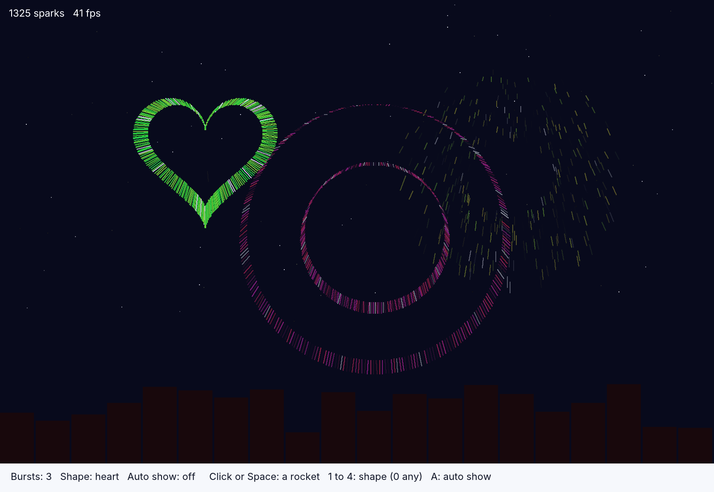
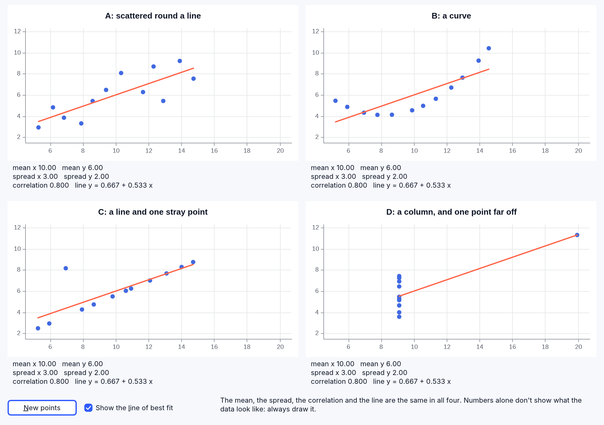
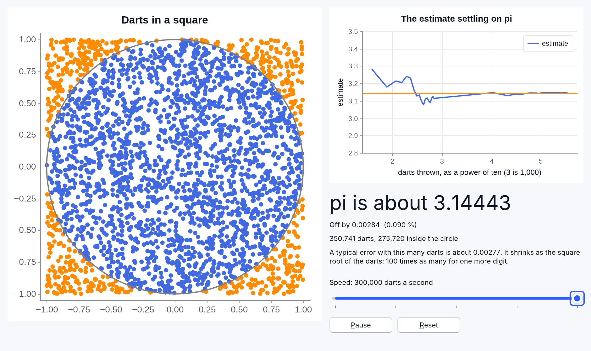
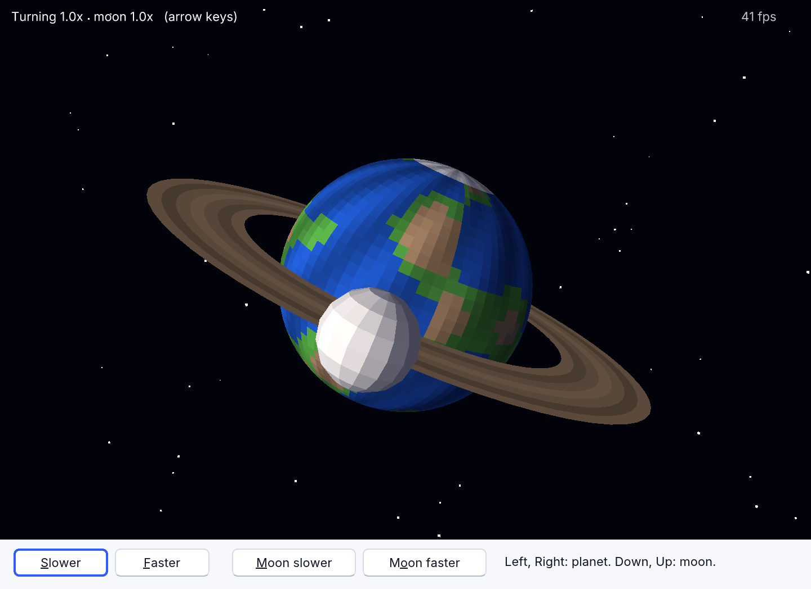
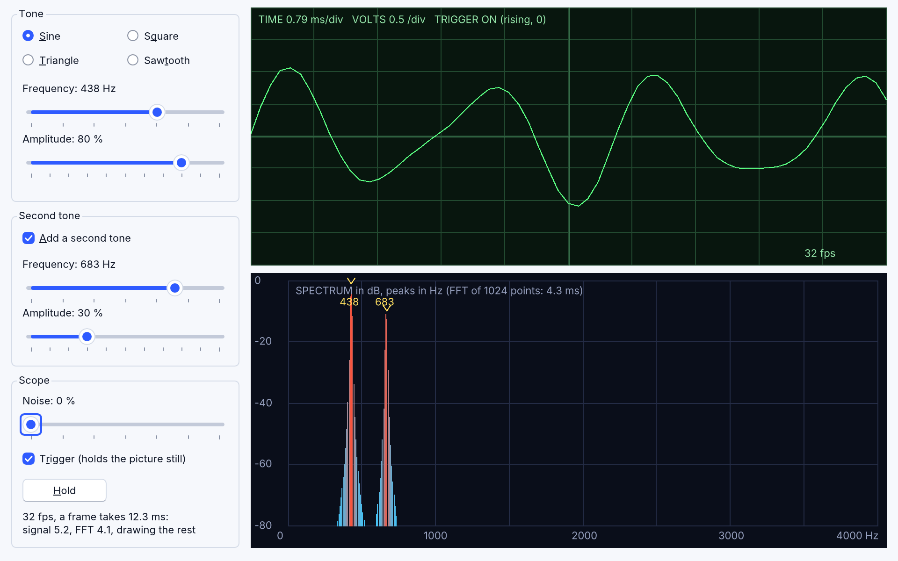
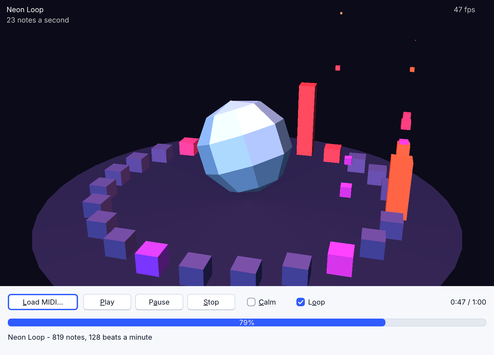

# Showcase: bigger programs

These programs are in [`examples/showcase/`](../../examples/showcase/),
each one a whole program in one file, written from an idea and from nothing
else: no one's code was copied, the data is made up by the programs
(except the weather one, which asks a public weather service), and each
uses only what RapidR has today. Open them in RapidR Studio from **Open an
Example** on the Welcome page (it lists them with the other examples), or
run them from a terminal; the first lines of each say how.

All of them run as the interpreter runs them (`rapidr run`), as a
standalone executable made with `--interp`, as a native build and in a
browser, and they follow the system's light, dark or high-contrast look.
Where a program needs something a browser can't give it, its section says so.

| Program | What it shows |
|---|---|
| [Fireworks](#fireworks) | thousands of sparks, each with its own physics; RNum draws the shapes |
| [Same numbers](#same-numbers) | four sets of points with the very same statistics and four different pictures, made by the program |
| [Pi by darts](#pi-by-darts) | RNum throws and counts thousands of random darts; the estimate and its error update live |
| [A planet](#a-planet) | a lit, shaded 3D planet with a ring and a moon, built from faces |
| [Signal lab](#signal-lab) | a signal generator, an oscilloscope held still by a trigger, and an FFT written in BASIC |
| [A MIDI visualizer](#a-midi-visualizer) | a 3D scene that dances to a song the program reads itself |

## Fireworks

[`fireworks.rr`](../../examples/showcase/fireworks.rr): click the sky, or
press Space, and a rocket flies up and bursts into a ball, a ring, two
rings or a heart. Keys 1 to 4 pick the shape, 0 lets the program choose, A
turns on an automatic show. The corner shows how many sparks are flying and
how many frames a second the program draws.



Every spark is one place in a set of arrays. This is all a spark's life,
once a frame, for each spark that is still flying:

```basic
svy(i) = (svy(i) + GRAVITY * dt) * drag      ' gravity pulls it down, the air slows it
svx(i) = svx(i) * drag
sx(i) = sx(i) + svx(i) * dt                  ' it moves
sy(i) = sy(i) + svy(i) * dt
f = f - fade(i) * dt                         ' and its life runs out
```

`dt` is the time since the last frame, so the sparks fly the same speed on
a slow computer and a fast one. A spark is drawn as a short line from where
it is to where it just was, in a colour that dims as its life ends:

```basic
c = RGB(8 + cr(i) * br, 10 + cg(i) * br, 28 + cb(i) * br)
Sky.Line sx(i), sy(i), sx(i) - svx(i) * dt * 4, sy(i) - svy(i) * dt * 4, c
```

New sparks take the next free place in the arrays, and when the arrays are
full the oldest spark makes room (`head = (head + 1) MOD MAXSPARKS`), so
the program never allocates anything while it runs.

**The shapes are sums on whole arrays.** A burst of `n` sparks needs `n`
angles round a circle and a speed for each. `RNum`, RapidR's array of
numbers, makes them in one step each, with no loop:

```basic
Ang.Linspace 0, PI2, n                 ' n angles round the circle
Ang.Add(RND * PI2)                     ' turned a random amount
Spd.Uniform 0.35, 1, n                 ' speeds, from 35 % to the full 100 %
Vx.Data = Ang.Data: Vx.Cos             ' the direction: cos and sin of the angle
Vy.Data = Ang.Data: Vy.Sin
```

A ring is the same with every speed equal (`Spd.Full n, 1`). The heart is
the classic heart curve, worked out on the whole array: `Vx.Sin` then
`Vx.Power 3` then `Vx.Multiply 16` is sixteen times the cube of the sine of
every angle, in three statements.

**Frames come from an `RDXTimer`.** `RDXScreen` is a surface the program
draws on and shows with `Flip`; the timer with `Interval = 0` fires once a
frame, and its `FrameRate` property is the number in the corner. The program
draws about two thousand lines a frame, and measures:

| Where | Sparks | Frames a second |
|---|---|---|
| The interpreter on a Mac (headless, software drawing) | about 1,000 | 38 to 46 |
| The browser (headless Chromium) | about 1,800 | 35 |
| The browser (headless Chromium) | 2,500 to 2,900 | 27 to 40 |

The cost is the drawing calls: each takes about 5 microseconds, so 2,000
sparks are about 10 milliseconds of the frame's 16 or 33; the arithmetic for
all of them takes less than one millisecond.

## Same numbers

[`same_numbers.rr`](../../examples/showcase/same_numbers.rr) shows how much
a handful of numbers can hide. Four sets of points are built to have the same
mean and spread in x and in y, the same correlation and so the same line of
best fit, and yet one is a loose cloud round a line, one a curve, one a line
with a stray point and one a column of points with a single point far away.
Under each chart are the numbers, **measured from the points drawn** with
`RNum`; they come out the same four times. **New points** makes four other
sets with the same numbers; **Show the line of best fit** switches the line.
(An idea first shown by F. J. Anscombe in 1973; the points here are made by
the program, not copied.)



**How the program makes them.** It doesn't search for lucky points; it builds
each set so that the numbers are right. Make x have mean 0 and spread 1
(`xs`). Take a "shape" (random noise, the square of x, one point set to 1, a
ramp) and remove from it its mean and everything it has in common with x:

```basic
dot = 0
FOR i = 0 TO N - 1: dot = dot + (ss(i) - m) * xs(i): NEXT
dot = dot / N
FOR i = 0 TO N - 1: ss(i) = ss(i) - m - dot * xs(i): NEXT
```

What is left, scaled to spread 1, is a shape that is exactly uncorrelated with
x. Then y is a blend of x and the shape, and its correlation with x is exactly
the wanted one, `R`:

```basic
ys = R * xs(i) + SQR(1 - R * R) * ss(i) / ssv
px(k, i) = MX + SX * xs(i)
py(k, i) = MY + SY * ys
```

The last two lines stretch both to the wanted mean and spread. Since
the correlation, both spreads and both means are the same, so is the line:
its slope is the correlation times the spread of y over the spread of x. The
curve is the square of x mixed in, the stray point is a shape that is 0
everywhere but one place (the other points then lie exactly on a line), the
column puts every x at one value but one.

**The numbers shown are measured, not promised.** `Describe` fills an `RNum`
with the x and y of each set and asks it:

```basic
mx = Xs4(k).Mean: my = Ys4(k).Mean
sdx = Xs4(k).Std: sdy = Ys4(k).Std
cov = Tmp.Mean - mx * my                    ' Tmp holds x * y for every point
rr = cov / (sdx * sdy)
```

Each chart is an `RPlot` made in code (`DIM Chart(3) AS RPlot`, then
`Chart(q).Parent = Form` and its place) with a `Scatter` series for the points
and a `Plot` series for the line, all four on the same axes (`Xlim`, `Ylim`)
so that their shapes can be compared.

## Pi by darts

[`monte_carlo_pi.rr`](../../examples/showcase/monte_carlo_pi.rr): random
darts land in a square. The ones inside the circle that just fits in it are
blue, the others orange. The circle is pi/4 of the square, so four times the
share of darts inside estimates pi, and the more darts, the better. The window
shows the estimate, how far off it is (and as a percentage), what a typical
error would be with that many darts, and a chart of the estimate settling on pi.
The slider sets the speed from 30 darts a second to 300,000; **Pause** and
**Reset** do what they say.



A batch of darts is thrown and counted by `RNum`, the numeric arrays, in a few
statements for the whole batch, however many darts it has:

```basic
Dx.Uniform -1, 1, batch                      ' every dart's x and y, in the square
Dy.Uniform -1, 1, batch
R2.Data = Dx.Data: R2.Square                 ' x * x
T.Data = Dy.Data: T.Square                   ' y * y
R2.Add "T"                                   ' x * x + y * y: the distance squared
R2.Subtract 1: R2.Sign: R2.Clip 0, 1         ' 1 where it is more than 1: outside
outside = R2.Sum
```

`Sign` turns each number into -1, 0 or 1, `Clip 0, 1` keeps the 1s (the
darts outside) and `Sum` counts them: that is why the slider can go to 300,000
darts a second while the program draws only the first 3,000 as dots (a dot
needs a method call of its own: `InX.Push x`). The chart's x is the number
of darts as a power of ten (`LOG(total) / LOG(10)`), so the early, wild
estimates and the later, calm ones both show. Both pictures are `RPlot`
components on the form: the program changes their series and calls `Show`;
`Board.Scatter(InX, InY, "inside", "royalblue")` is a series of points,
`Settle.Hline PI, "darkorange", "pi"` the line the estimate settles on.

## A planet

[`spin3d.rr`](../../examples/showcase/spin3d.rr): a planet with oceans, land
and ice caps, a ring and a moon going round it, in front of stars, lit by a
sun. The **left and right arrow keys** slow down and speed up the planet's
turning, **down and up** the moon's going round; the four buttons do the same.



Everything is built by the program from faces, a face being a flat polygon
with a colour. A face's corners are listed clockwise as seen from outside,
the way Direct3D tells its front, which is the side that is drawn. The planet
is a ball of 36 rings of 72 faces; the lines that matter in `BuildPlanet`:

```basic
DX.CreateFace(Face)
Face.AddVertex(radius * SIN(a0) * COS(b1), radius * COS(a0), radius * SIN(a0) * SIN(b1))
...
land = SIN(3 * bm + 2 * SIN(2 * am)) + SIN(2 * am * 2.5 + bm * 1.5) + 0.6 * SIN(7 * bm - 3 * am)
IF land > 0.55 THEN Face.SetColorRGB(0.28 * shade, 0.58 * shade, 0.24 * shade)
MB.AddFace(Face)
```

`a` is the angle from the north pole and `b` the angle round the axis; the
land is where three waves of different sizes, laid over one another, are high,
which makes continents (and the same planet every time). Ice is near the poles.

**Frames make it move.** A frame is a place in the scene; things attached to
it go where it goes. The planet, the ring and the moon's orbit are in a frame
that leans over 23 degrees (`Tilt.SetOrientation(0, 0, 1, 0.4, 0.92, 0)`: the
second three numbers are which way is up for it), so everything turns about
the planet's leaning axis. Each frame the program says how far every part
turns, and calls `DX.Move(1)`:

```basic
PlanetFrame.SetRotation(0, 1, 0, spinSpeed * dt)
MoonOrbit.SetRotation(0, 1, 0, moonSpeed * dt)
MoonFrame.SetRotation(0, 1, 0, 1.5 * dt)
DX.Move(1)
```

The moon sits at 3.5 to the side in `MoonOrbit`, which turns, so it goes
round; its own frame turns it about itself. The planet is smooth (the default
Gouraud shading blends the light across faces) and the moon, made with
`SetQuality(D3DRMRENDER_FLAT)`, shows its facets. The stars are 700 tiny
squares far away drawn "unlit" (`D3DRMRENDER_UNLITFLAT`), so they are plain
white whatever the lights do. The arrow keys come to the form first
(`KeyPreview = 1`) and the handler uses the key up (`Key = 0`) so that a
button with the focus doesn't also react.

## Signal lab

[`signal_lab.rr`](../../examples/showcase/signal_lab.rr) is a small
instrument for engineers and for anyone curious about waves. Pick a **sine**,
**square**, **triangle** or **sawtooth** wave, set its frequency, amplitude
and the noise on it, and add a second tone. The top screen is the signal as
an oscilloscope shows it; the bottom screen is its **spectrum** (how much of
each frequency is in it), with the highest peaks marked in hertz. The signals
are made up by the program, there is no microphone: RapidR can't listen yet.



Try this: choose **Square**, switch the second tone off, and look at the
spectrum. A square wave is a sine and its odd multiples, each smaller than the
last: peaks at 438, 1314, 2190, 3066 and 3942 Hz. The sixth peak is not a
multiple that fits: the program makes 8192 samples a second, so it can only
see up to 4096 Hz, and the 11th multiple (4818 Hz) folds back to 3374 Hz, as
it does on a real analyzer (aliasing).

**The trigger.** A scope draws the signal again and again; the trigger makes
each picture start at the same point of the wave, so it stands still. Here it
looks through the frame for the first place the signal climbs through zero
and starts drawing there. Switch **Trigger** off and the wave runs about:

```basic
FOR k = 3 TO M - N - 1
    IF sig(k - 2) < 0 AND sig(k - 1) < 0 AND sig(k) >= 0 THEN
        trig = k
        EXIT FOR
    END IF
NEXT
```

(Two samples below zero and then one at or above it: a little noise on the
signal can't fool it.)

**The FFT.** A Fast Fourier Transform turns 1,024 samples into how much each
frequency adds up to. The program has its own, in about 30 lines of BASIC (it
shows that RapidR does real arithmetic: this runs 30 times a second, a
frame's FFT takes 4 to 6 milliseconds). It first swaps the samples into
"bit-reversed" order, then combines pairs into fours, eights, and so on,
with the "butterfly" at its middle:

```basic
tr = wr * re(j) - wi * im(j)
ti = wr * im(j) + wi * re(j)
re(j) = re(i) - tr: im(j) = im(i) - ti
re(i) = re(i) + tr: im(i) = im(i) + ti
```

`re` and `im` hold the real and imaginary parts; `wr` and `wi` are the turning
factor, taken from a table of cosines and sines made once at the start. Before
the FFT each sample is multiplied by a Hann window,
`0.5 - 0.5 * COS(2 * PI * q / (N - 1))`, which is 0 at both ends of the frame,
so that the frame's cut ends don't smear the peaks; after it, the size of
each frequency is `SQR(re * re + im * im)`, scaled so a tone of amplitude 1
reads 1, and drawn in decibels: `20 * LOG(mag) / LOG(10)`.

**The peaks** are the points higher than both neighbours and within 30 dB of the
highest. A peak between two points of the spectrum is found more exactly by
the parabola through the three points: `best + 0.5 * (a - c) / (a - 2 * b + c)`
(`a`, `b` and `c` are the decibels at the point before, at it and after it),
so 438 Hz reads as 438 and not as the nearest multiple of 8. A screen reader
is told the peaks too: the spectrum's `AccessibleDescription` is "Peaks at 438
Hz, 683 Hz" and is renewed once a second.

The screens are two `RCanvas` components drawn in their `OnPaint`; the timer
makes the next frame and calls `Repaint`. Measured, at 1,024 points a frame:

| Where | Frames a second | Making the signal | The FFT | A whole frame |
|---|---|---|---|---|
| The interpreter on a Mac (headless) | 30 to 33 | 4 to 6 ms | 4.4 ms | 11 to 14 ms |
| The browser (headless Chromium) | 31 | 5.2 ms | 6.2 ms | 14.7 ms |

## A MIDI visualizer

[`midi_visualizer.rr`](../../examples/showcase/midi_visualizer.rr): a song
plays and a 3D scene reacts to it, note by note. **Load MIDI…** opens any
`.mid` file and the same scene follows it; **Play**, **Pause** and **Stop**
do what they say; **Loop** plays the song again when it ends; **Calm** makes
every movement gentler. The song it opens with is `song.mid`, an original
32-bar loop made by [`make_song.rr`](../../examples/showcase/make_song.rr)
(below).



What moves what:

| In the song | In the scene |
|---|---|
| a kick drum | the crystal pulses (and the background brightens a little) |
| the pitch of a note | the colour of its column and spark: low notes deep blue, then violet and pink, the high ones orange; and how high they go |
| a bass note | a low jump of its column and a shake of the camera |
| the notes a second | how fast the ring turns |
| a crash or snare | a push to the turning |

The colour of the light over the floor follows the notes smoothly, over a
third of a second, and kick pulses are at least a third of a second apart,
so nothing flashes: the scene is built not to be a problem for people who
are sensitive to flashing lights (it follows the idea of the three-flashes
rule, WCAG 2.3.1; it hasn't been tested by anyone medical, and **Calm**
softens the movement further).

**The program reads the MIDI file itself.** A MIDI file is a header and
chunks of events, each event after a "delta time", the ticks since the one
before, written as a variable-length number: seven bits a byte, the high
bit set on every byte but the last. This function reads one:

```basic
FUNCTION ReadVLQ AS LONG
    DIM v AS LONG, b AS INTEGER
    DO
        b = Rd.ReadByte
        v = v * 128 + (b AND 127)
    LOOP WHILE b >= 128
    ReadVLQ = v
END FUNCTION
```

`Rd` is an `RFileStream`; `ReadByte` reads the next byte. A track is read
event by event. A status byte starts an event, but a MIDI file may leave it
out when it is the same as the last one ("running status"), so the reader
puts the byte back when it isn't a status:

```basic
b = Rd.ReadByte
IF b >= 128 THEN
    status = b
ELSE
    status = run                      ' running status: the byte was data
    Rd.Position = Rd.Position - 1
END IF
```

A meta event (`&HFF`) carries the tempo (`&H51`, the microseconds in a
beat) and names; the reader keeps those and every Note On with a velocity
above 0, and skips the rest by its length. Notes are counted in ticks, so
`TickMs` walks the tempo changes to turn each into milliseconds. The notes
of all the tracks are then put in time order with one sort: each note
becomes the number `milliseconds * 100000 + its number`, and `QUICKSORT`
sorts those numbers:

```basic
sortKey(i) = INT(TickMs(rawTick(i))) * 100000 + i
...
QUICKSORT sortKey(0), sortKey(noteCount - 1), 0
```

**RMIDI plays; the program watches the clock.** `Midi.Timer.Interval = 20`
makes RMIDI tell the program the song's position in milliseconds fifty times
a second (`Midi.OnChange = Moved`). Each frame, every note that is due
moves something:

```basic
DO WHILE nextNote < noteCount AND Midi.State = MD_PLAY
    IF noteMs(nextNote) > songPos THEN EXIT DO
    NoteOn noteChan(nextNote), noteKey(nextNote), noteVel(nextNote)
    nextNote = nextNote + 1
LOOP
```

RapidR has a General MIDI synthesizer of its own, so the song is heard on
every system and in the browser, whether or not the system has one. The 3D is
`RDXScreen` with Direct3D objects: frames, lights, a camera and meshes the
program builds from faces (a box, a crystal ball and a disc: `BuildBox`,
`BuildBall`, `BuildDisc`). The ring turns by setting a frame's rotation and
calling `DX.Move`; a pulse is `GemPulse.AddScale(0, size, size, size)`; the
shake is a small random move of `DX.SetCameraPosition`.

Run `rapidr run midi_visualizer.rr 40` to start the song at its 40th second.

### make_song.rr: the song

[`make_song.rr`](../../examples/showcase/make_song.rr) composes `song.mid`
and writes it as a standard MIDI file, with an `RFileStream`'s `WriteByte`.
It makes five tracks (the tempo, drums, bass, arpeggio and pad), 32 bars at
128 beats a minute in A minor on the chords Am, F/A, C and G: four on the
floor, an off-beat bass, an arpeggio in sixteenths and a pad. A new layer
joins every eight bars, and the last bar of each section is a snare roll.
Every note comes from the rules in the program; nothing is copied from a
song. Notes are put in time order the same way the visualizer does it, with
`QUICKSORT` on numbers that hold the tick and the note's place, and each
event's delta time is written with this:

```basic
SUB Delta (n AS LONG)
    DIM groups(4) AS INTEGER, g AS INTEGER, v AS LONG
    v = n
    groups(0) = v AND 127                         ' the last 7 bits
    g = 0
    v = v \ 128
    DO WHILE v > 0
        g = g + 1
        groups(g) = (v AND 127) OR 128            ' more bits: the high bit set
        v = v \ 128
    LOOP
    DO WHILE g >= 0
        PutByte groups(g)                         ' the biggest group first
        g = g - 1
    LOOP
END SUB
```

The song in the repository is the one the program makes: the examples' tests
run `make_song.rr` and compare its `song.mid` with the shipped one, byte
for byte.
