# The code editor in RapidR Studio

RapidR Studio's code editor knows your program as the compiler does. While
you type it suggests names, shows the parameters of the call you are
writing, explains any word you point at, jumps to where a name is defined,
and marks mistakes before you run. It works the same in the desktop Studio
and in Studio on the web.

The pictures below were made with `examples/gui/hello_form.rr` open (File >
Open Example…, then **Code** at the top right of its tab, or F7).

On a Mac, use **⌘ Cmd** where this page says **Ctrl** — except Ctrl+Space and
Ctrl+Shift+Space, which stay on the Control key (⌘ Space is Spotlight).

## Completion: names as you type

Start typing and a list of what fits appears under the caret. Type a dot
after a component and the list shows its properties, methods and events:

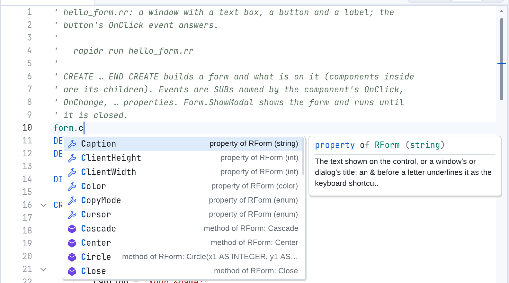

- The list narrows as you type. It matches the start of words too:
  `sm` finds `ShowModal`.
- The box on the right describes the selected entry: its type, what it does,
  and whether it is RapidR's own.
- **Tab** or **Enter** puts the selected name in. **Escape** closes the list.
  **↑ ↓ Page Up Page Down** move through it. A click also chooses.
- Names you chose recently come first next time.

The list knows what each name is:

```basic
DIM Ok AS RBUTTON
Ok.          ' RButton's members: Caption, Left, OnClick …

DIM Buttons(3) AS RBUTTON
Buttons(1).  ' the same, for an element of an array

TYPE Point
    X AS INTEGER
    Y AS INTEGER
END TYPE
DIM p AS Point
p.           ' X and Y

WITH Ok
    .        ' RButton's members again
END WITH

CREATE Form AS RFORM
    Cap      ' inside a CREATE: what you can set — Caption = …
END CREATE
```

After `AS`, the list offers the built-in types, your TYPEs and every
component under RapidR's names (`RButton`, `RForm`). The older Q names
(`QButton`, `QForm`) work exactly the same: start typing one (`QBu`) and
the list offers it too, after RapidR's. In a file that already uses
Q names, the list offers those instead (and RapidR's once you type
an `R`), so a file keeps one style.

### Ctrl+Space

**Ctrl+Space** (Edit > Complete Word) opens the list at any place, also on an
empty line. There it shows your program's own names first — its variables,
components, SUBs and FUNCTIONs — then RapidR's functions, statements and
constants:

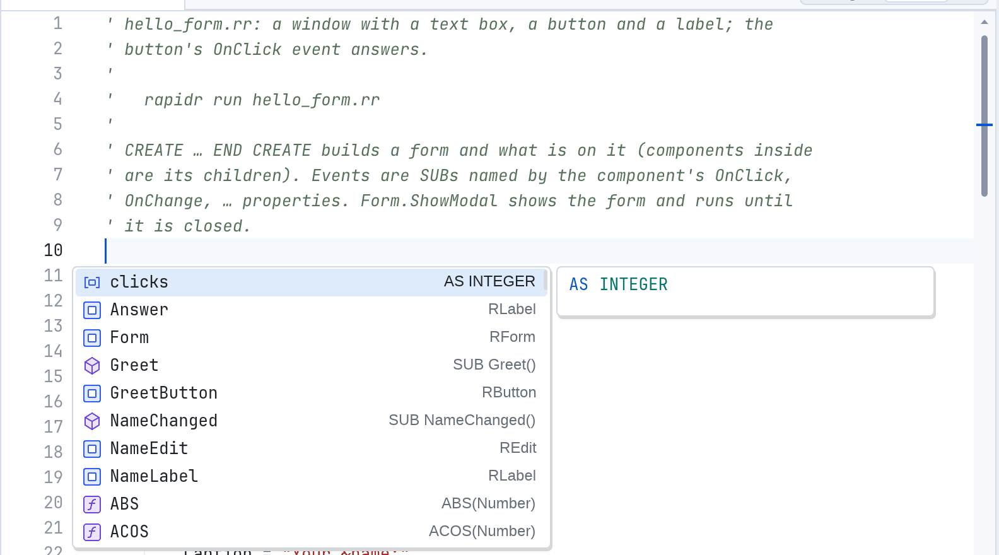

### RAPIDQ.INC's constants

Constants such as `mbYes`, `mtWarning`, `clRed` or `fmOpenRead` are built
into a RapidR program (`.rr`): the list offers them as they are, and you
need no include line
([Constants](language.md#constants-clred-mbyes-vk_escape)).

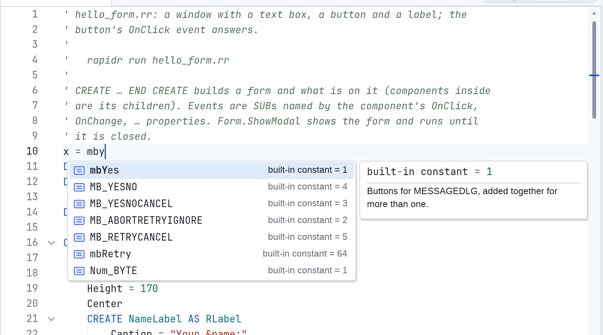

In a RapidQ program (`.bas`) they come from the include file RAPIDQ.INC, as
in RapidQ. The list offers them even before your program includes it, and
choosing one also adds the line `$INCLUDE "RAPIDQ.INC"` at the top of the
file (after its first comments). Ctrl+Z takes both back.

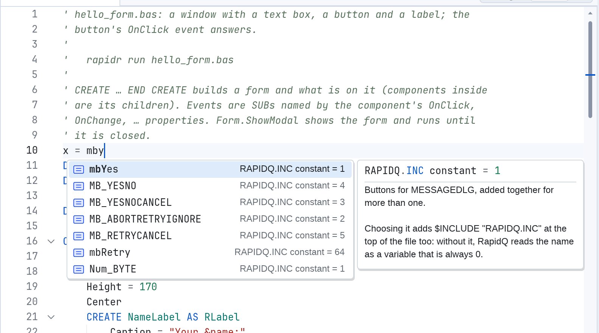

## Parameter info

Type `(` after a SUB, FUNCTION or method, and a box above the line shows
its parameters, the one you are typing in bold. It follows as you type
commas, and closes after the `)`.

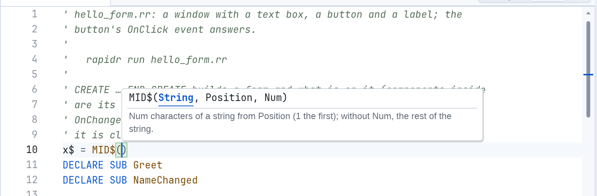

To see it again, press **Ctrl+Shift+Space** (Edit > Advanced > Parameter
Info). It works for your own SUBs and FUNCTIONs as well:

```basic
SUB Greet(Name AS STRING, Times AS INTEGER)
    ...
END SUB

Greet("Ann",     ' the box shows Greet(Name AS STRING, Times AS INTEGER), Times in bold
```

## Hover: what a word is

Rest the mouse on a word for half a second and a box tells you what it is:
a statement's syntax and what it does, a component's property with its type,
or your own variable with its declaration and how often it is used. Edit >
Advanced > Show Hover does the same for the word at the caret.

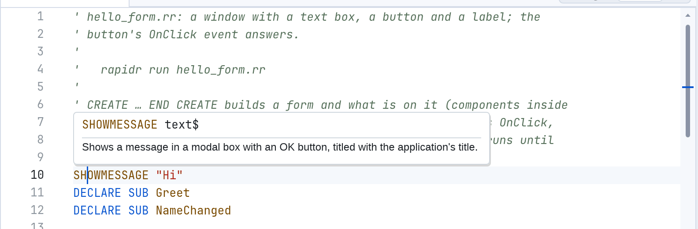

F1 opens the full entry in the Help pane.

## F12: Go to Definition

Put the caret on a name and press **F12** (Edit > Go to Definition): the
caret jumps to where the name is defined — the SUB of a call, the `DIM` of a
variable, the `CREATE` of a component. If that is in another file (an
`$INCLUDE`), Studio opens it there. For a variable your program never
declares, F12 goes to the first place it is given a value.

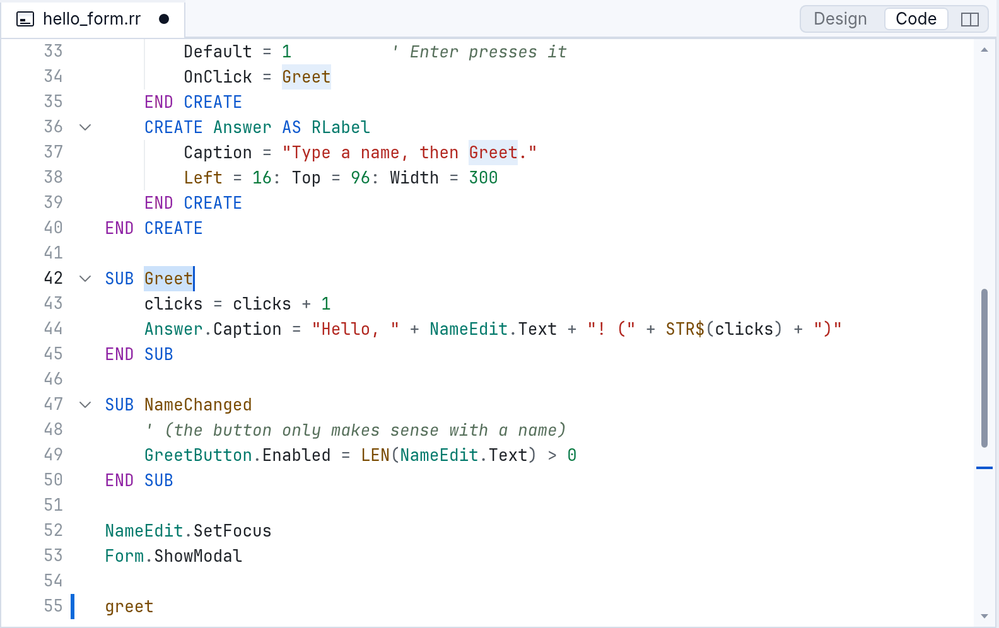

F12 works in the code of a form's file too. With the caret off a name (or
in the designer), F12 switches between the form's designer and its code;
**F7** (code), **Shift+F7** (designer) and the **Design | Code**
switch at the right of the tab do too.

Related: **Shift+F12** (Find References) selects every use of the name and
lists them in Output; **F2** renames a name everywhere it is used.

## Problems while you type

When you open a file, and when you stop typing for a moment, Studio checks
the program and underlines what's wrong with a wavy line: red for errors,
amber for warnings. A sign in
the margin marks the line, and the **Problems** tab under the editor (View >
Problems) lists them all, with their place. Click one to go there. The
messages are the compiler's own words, so they read the same as when
you build.

### The RAPIDQ.INC warning

In a RapidQ program (`.bas`), RapidR, to run old programs the same way,
reads a name it doesn't know as a new variable that is 0. So if such a
program uses `mbYes` without including RAPIDQ.INC, `mbYes` is 0, and a
question like this one shows only an OK button (a `.rr` program has the
constants built in: no warning there):

```basic
IF MessageDlg("Save changes?", mtWarning, mbYes OR mbNo, 0) = mrYes THEN
```

Studio warns about each such name:

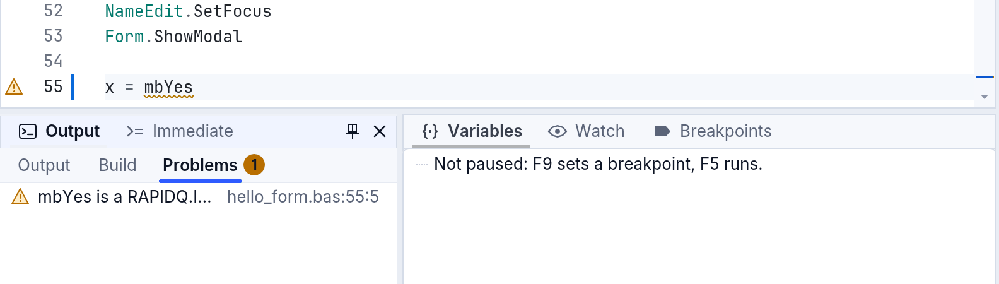

### Quick fixes: Ctrl+.

Put the caret on an underlined word and press **Ctrl+.** (Edit > Quick
Fix…). A list of fixes appears; **Enter** applies the first. For the
warning above, the fix adds `$INCLUDE "RAPIDQ.INC"` to the top of the file:

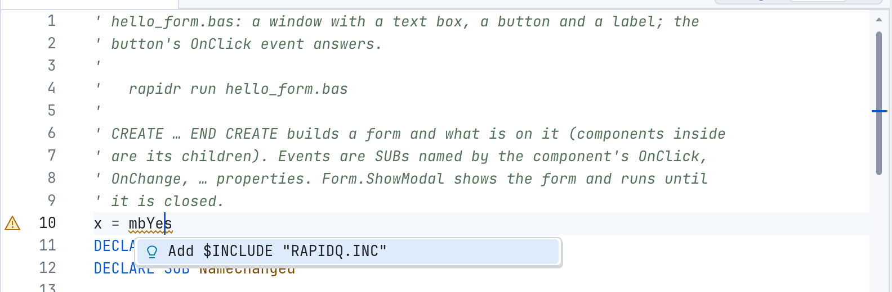

Other fixes: a misspelt property (`NameEdit.Txet`) offers the nearest real
ones ("Change to Text"); in a RapidQ-compatible project, a Q name that
doesn't exist (`QPLOT`) offers RapidR's (`RPLOT`).

`IF NOT FILEEXISTS(f) THEN` looks right but is always true: FILEEXISTS
gives 1 when the file is there, and `NOT 1` is -2 — true as well. Studio
underlines it, and the fix writes the test that works,
`IF FILEEXISTS(f) = 0 THEN` (DIREXISTS the same):

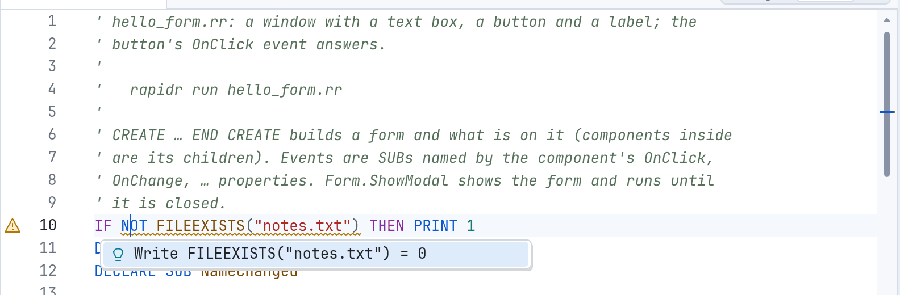

## Typing help

- **Tab** at the start of a line indents it by the file's unit (four spaces,
  or a tab if the file uses tabs); **Shift+Tab** takes it back. On several
  selected lines they indent or outdent them all. Tab never puts a stray
  character in your code.
- Keywords are written in capitals as you finish each word (`dim` → `DIM`),
  and your own names as you declared them (`nameedit` → `NameEdit`).
- Brackets and quotes close themselves; typing the closing one steps over
  it.
- Snippets: type `sub`, `function`, `if`, `for`, `select`, `create`, `type`,
  `while`, `do` or `with` and press Tab for the whole block; Tab again moves
  to the next part to fill in.

## Helpers

The code shows its own values. When a line sets a colour, a small swatch of
that colour sits right after it; a picture's name shows the picture; a
font's name shows a small sample. Click the mark, or put the caret
on the value and press **Ctrl+.**, and an editor opens beside it. What you
pick is written back into your code, as one step that **Ctrl+Z** undoes.

The pictures below were made with `examples/studio/helpers.rr` open (File >
Open Example…, "The code shows its own values").

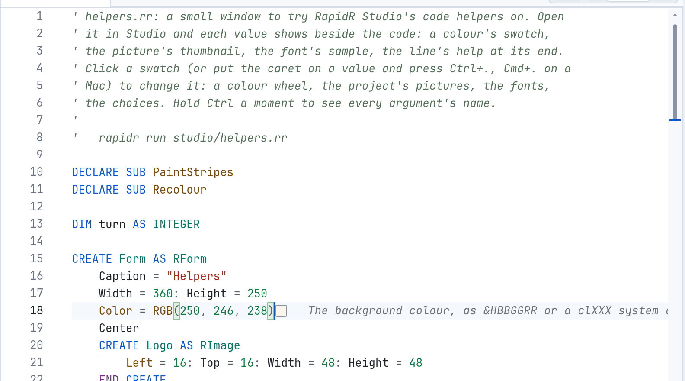

### Colours

A colour written as `RGB(255, 130, 20)`, as `&H1482FF` or as a constant
(`clTeal`) shows its swatch. Its editor has a colour wheel with a square for
how strong and how bright, the Red, Green, Blue and Hex numbers, the
colour's name in words, the old colour beside the new one, and a palette:
the colours your program already uses first, then the standard and the
system colours.

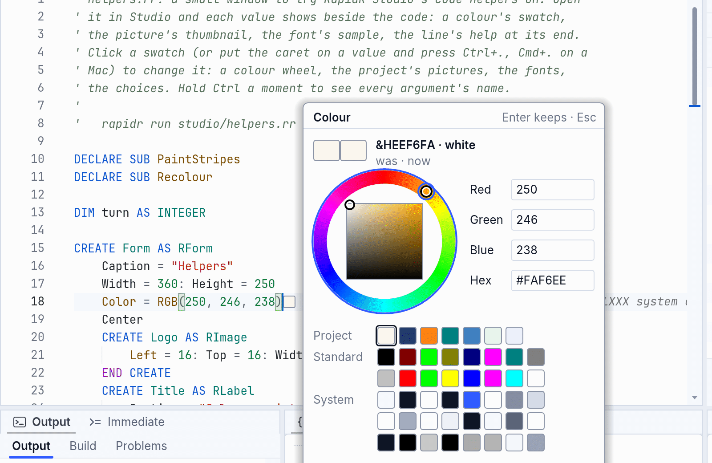

Your code keeps its own way of writing the colour: `RGB(…)` stays
`RGB(…)`, `&H…` stays `&H…` with as many digits, and a constant stays a
constant when the new colour has a name (`clRed`; otherwise it becomes
`RGB(…)`).

Keys in the colour editor: **Tab** moves from the wheel to the square, the
four numbers, the palette and the buttons. On the wheel, the arrow keys turn
the colour a step (with **Shift**, ten); on the square, Left and Right make
it weaker or stronger, Up and Down brighter or darker. **Enter** keeps the
colour, **Esc** leaves the code as it was.

### Pictures, sounds and files

A picture's name (`Logo.Load "logo.svg"`, a button's `BMP`) shows a small
thumbnail. When the file isn't in your project, a red mark shows instead,
so a typing mistake shows before you run. A sound shows a ▶ mark.

The file editor lists your project's files of that kind, with a preview of
the picture you are on; type to filter the list, **Enter** picks.

Pictures are only ever read from inside your project's folder, never from
anywhere else on your computer, and nothing is fetched from the internet.

### Fonts

A font's name (`TitleFont.Name = "Inter"`) shows a small "Aa" sample. Its
editor lists the fonts on your computer with a preview line (in the
Properties panel, the size, Bold and Italic too). The sample and the preview
are drawn the way your program will draw the font: RapidR draws every
program with its own built-in faces, so a program looks the same on every
computer, and a font it doesn't have is drawn in the nearest of them.

### Choices, True or False, and links

**Ctrl+.** on a constant opens the list of the ones that fit there:
`Align = alClient` offers `alNone`, `alTop` … `alClient`. For a set of flags
(`MESSAGEDLG`'s buttons, `mbYes + mbNo`) each has a tick box: **Space**
ticks, **Enter** writes them all. On `True` or `False`, **Space** turns it
over.

On an event (`OnClick = SaveClick`) the list offers your program's SUBs,
and first **Create handler "AgainClick"** (the component's name and the event's): it writes a new SUB for you, before
the form's CREATE block, links it, and puts the caret inside it, ready to
type — one undo step. It works on `OnClick =` with nothing after it yet,
too.

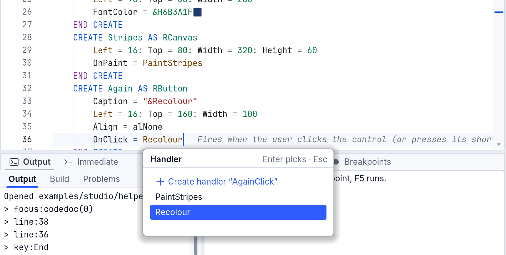

A link to another component (`PopupMenu = …`, `Parent = …`) offers the
components of your program that fit.

### The line's help and the argument names

The line the caret is on shows a short help at its end, in grey: what the
call or the property does. Calls with several numbers or texts show each
argument's name before it, as a small grey label (`x1:`, `c:`), so
`FillRect 0, 0, 107, 60, …` reads as what it means (a name that says
nothing, like `FORMAT$`'s `S$`, gets no label). Hold **Ctrl** a moment
to see every argument's name; let go and they go.

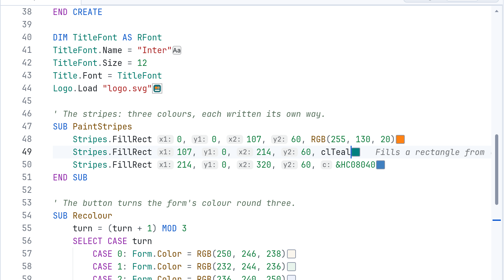

None of this ever moves your code about while you type: the marks and the
names keep their room on the line you are typing on until you leave it.

### Values while your program is paused

When the debugger stops (a breakpoint, a step), each line of the routine
it stopped in shows the values of the names it uses at its end, the same way
the Variables panel shows them (a colour as a swatch, an empty text as
`""`). They go when the program runs on.

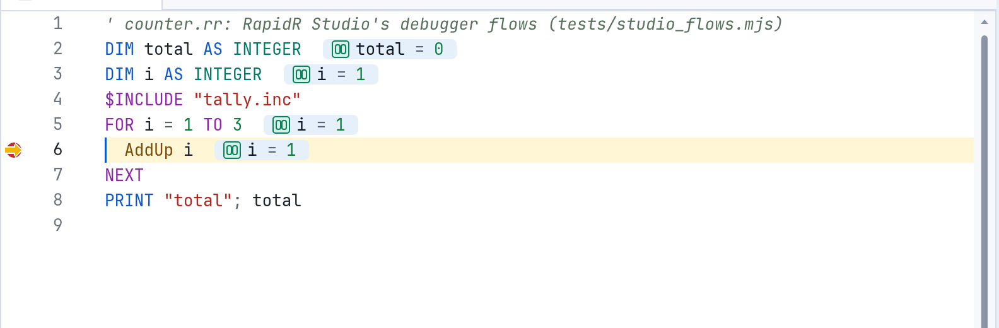

### How much shows

Tools > Settings > General > **Code helpers**:

- **Helpful** (the default): the marks, the line's help, the argument names
  for numbers and texts, and the values while paused;
- **Quiet**: the marks only;
- **Everything**: every argument's name, and a ▾ mark after each choice and
  link as well;
- **Off**.

### With a screen reader

**Ctrl+K**, then **H**, reads the caret's line with its helpers: "Color =
RGB(255, 130, 20); orange, 255 130 20". Nothing is announced while you type
as helpers come and go. The editors are dialogs inside the code editor:
each part is named, Tab moves through them, the focus never jumps.

## Keyboard shortcuts

| Keys | What it does | Menu |
|---|---|---|
| Ctrl+Space | Open completion here | Edit > Complete Word |
| Tab, Enter | Accept the selected suggestion | |
| Escape | Close the list or box | |
| Ctrl+Shift+Space | Parameter info | Edit > Advanced > Parameter Info |
| F12 | Go to Definition | Edit > Go to Definition |
| Shift+F12 | Find References | Edit > Find References |
| F2 | Rename everywhere | Edit > Rename Symbol… |
| Ctrl+. | On a value: its editor (colour, picture, font, choice, handler); elsewhere a quick fix | Edit > Quick Fix… |
| Ctrl+K, H | Read the line with its helpers (screen readers) | |
| Ctrl, held a moment | Show every argument's name | |
| F1 | Help on the word at the caret | Help |
| F7 / Shift+F7 | A form's code / designer | View > Code / Designer |
| Tab / Shift+Tab | Indent / outdent | Edit > Advanced > Indent / Outdent Lines |
| Ctrl+/ | Comment or uncomment the lines | Edit > Toggle Comment |
| Shift+Alt+F | Format the file | Edit > Format Document |
| Ctrl+F, Ctrl+H | Find, Replace | Edit > Find…, Replace… |
| F3 / Shift+F3 | Find next / previous | Edit > Find Next / Previous |
| Ctrl+Shift+F | Find in all the project's files | Edit > Find in Files… |
| Ctrl+G | Go to a line | Edit > Go to Line… |
| Ctrl+D | Select the next occurrence (several carets) | Edit > Advanced |
| Alt+Z | Word wrap on / off | Edit > Advanced > Word Wrap |
| Ctrl+Z / Ctrl+Y | Undo / redo | Edit > Undo / Redo |

## Settings

Studio keeps three editor settings in its registry key
(`HKCU\Software\RapidR\Studio`; on macOS and Linux RapidR's own registry
file):

- `KeywordCase`: `upper` (the default), `lower`, `proper` or `preserve`;
- `IdentifierCase`: `declaration` (your names as declared, the default) or
  `preserve`;
- `Helpers`: `helpful` (the default), `quiet`, `everything` or `off`
  (Tools > Settings > General > Code helpers).

Your own programs can use the same editor: it is the RCodeEditor component
(see [The code editor in your programs](code-editor.md), with its SQL mode,
and the [members reference](reference/members.md#rcodeeditor)).
