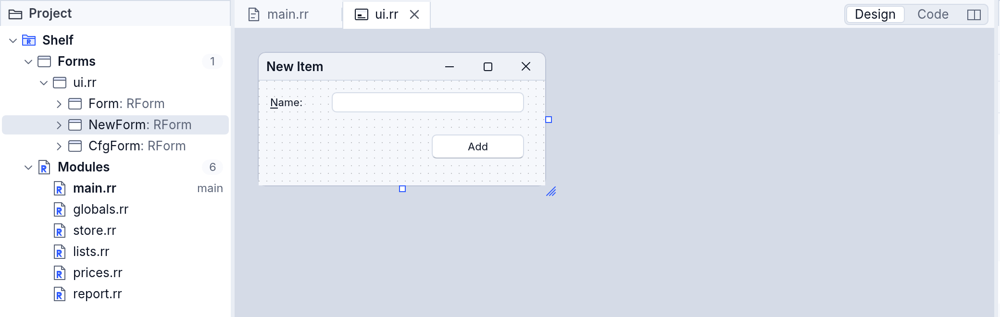
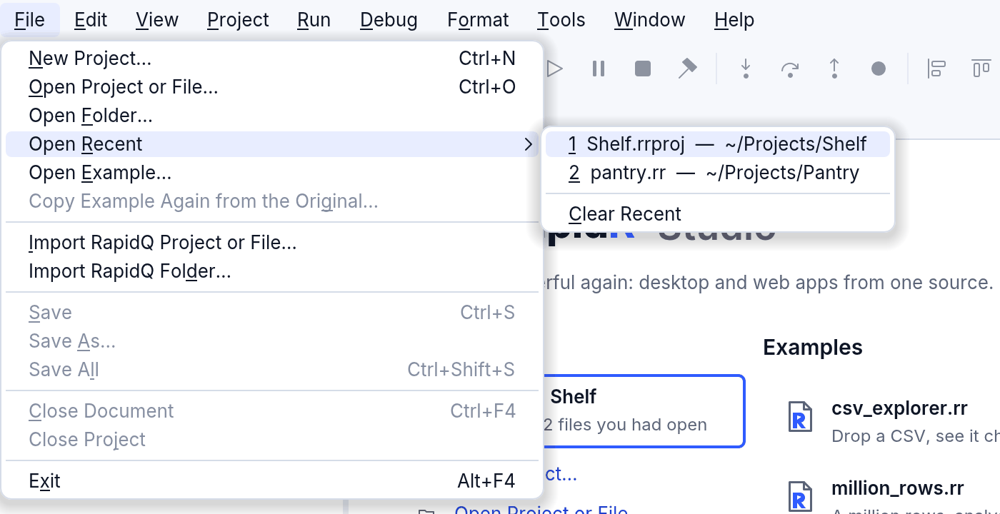
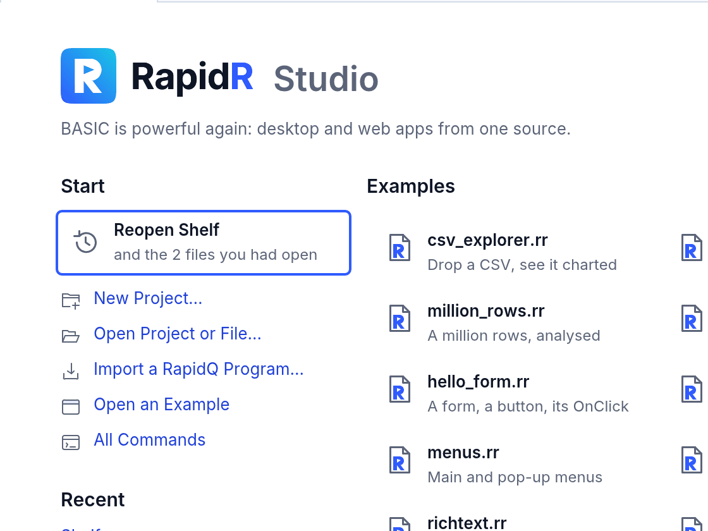
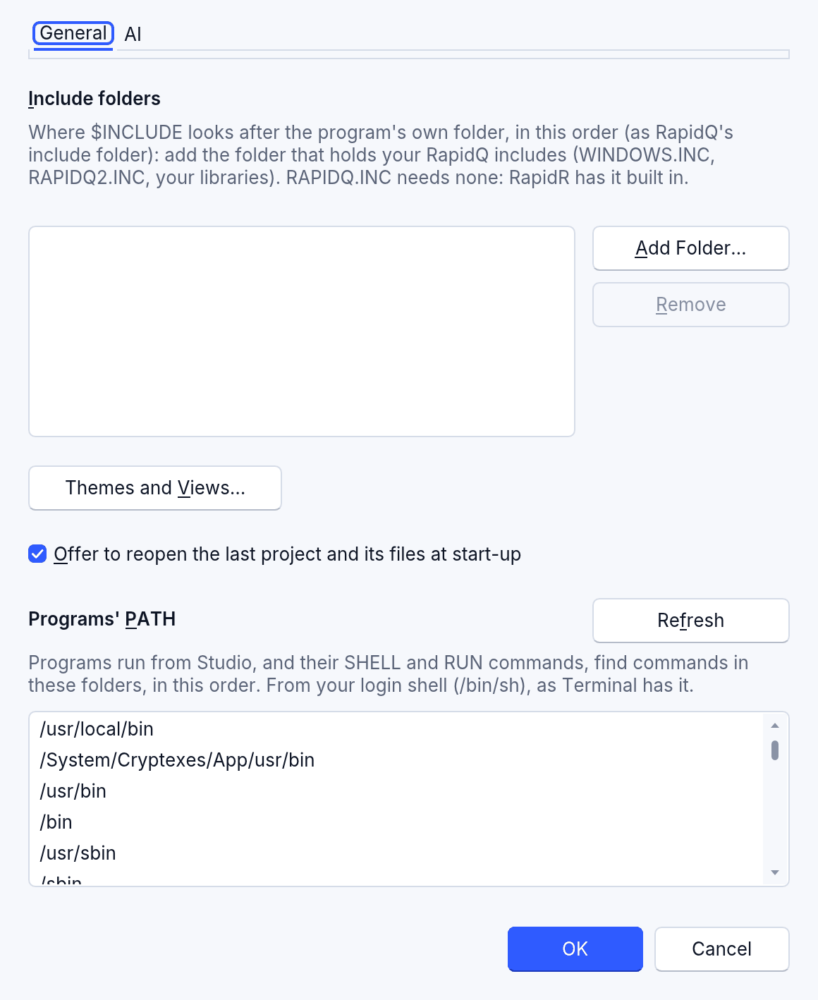

# Projects in RapidR Studio

A RapidR program can be one file or many: a main file that `$INCLUDE`s
the others. RapidR Studio keeps the list in a project file (`.rrproj`) and
shows it in the **Project** pane. This page covers what the Project pane
shows, opening what you worked on last, and the PATH your programs get when
Studio runs them.

The pictures were made with Studio's own seven-file test project
(`tests/fixtures/studio_forms` in RapidR's source): its windows are in
`ui.rr`, three forms in one file; the other files hold its SUBs and
FUNCTIONs.

## Forms come from your code

Any file that creates a form at its top level, with `CREATE Name AS RForm`
(or `RFormMDI`, or the older names `QFORM` and `QFORMMDI`), is a form file.
It shows under **Forms**, whatever the project file said about it. A file
that creates several forms shows each of them under it:

```basic
' ui.rr: the program's three windows
CREATE Form AS RForm
    Caption = "Shelf"
    ...
END CREATE

CREATE NewForm AS RForm
    Caption = "New Item"
    ...
END CREATE

CREATE CfgForm AS RForm
    Caption = "Options"
    ...
END CREATE
```



- **A file with several forms** opens in the tree to show its forms, one a
  line. Open one (double-click it, or select it and press Enter) and it
  shows in the file's designer. Select a form, or a component of one, and
  the designer switches to that form; it tells a screen reader which one
  ("Designing NewForm, form 2 of 3 in this file").
- **A file with no form** (the main file that only `$INCLUDE`s the others
  and starts the program, a file of SUBs) shows under **Modules**.
- **The tree follows your typing.** Add a `CREATE … AS RForm` to a module
  and it moves to Forms; take the last form out of a file and it moves back
  to Modules.
- **The project file follows too.** When you save (File > Save, Ctrl+S, or
  Save All), Studio writes the kinds your code says into the `.rrproj`, and
  the Output says what changed:

  ```text
  main.rr creates no form now: it's a module in the project
  ui.rr creates a form: it's under Forms in the project now
  Saved …/Shelf.rrproj
  ```

  A file the AI assistant writes for you is listed the same way: a new file
  that creates a form goes under Forms.

An include file (`.inc`) that creates a form is a form file too. One that
creates none stays under Includes.

## Open Recent

**File > Open Recent** lists the last ten projects and files you opened,
newest first, each with its folder. Press its number to open it. **Clear
Recent** empties the list (the files stay where they are).



From the keyboard: **Alt+F**, then **R** (on a Mac, the menu bar's File >
Open Recent). The command palette (Ctrl+Shift+P) has the same items under
"Open Recent". The Welcome page's **Recent** list shows the first six.

If something on the list isn't there any more (moved, renamed, on a drive
that isn't connected), choosing it takes it off the list, and the status
bar and the Output say so.

## Reopening the last project

When Studio starts without a file to open, the Welcome page offers the
project you had open last, with the files that were open in it:



The keyboard starts on the card: press **Enter** (or Space, or click it),
and the project opens with its files in their tabs and the layout you left.
To start somewhere else, use the other items on the page as usual.

You can turn the offer off in **Tools > Settings > General**: clear
**Offer to reopen the last project and its files at start-up**.

## The PATH your programs get

On macOS and Linux, an app started from the Dock, Finder or a desktop
launcher gets the system's short PATH (`/usr/bin:/bin:/usr/sbin:/sbin`), not
the one your Terminal has. A program that runs `SHELL "php -v"`, looks up
`curl`, or uses a Homebrew tool worked in Terminal and failed from Studio.

Studio reads your login shell's PATH once, when it starts, and gives it to
the programs it runs; their `SHELL` and `RUN` commands inherit it. Building
and Run in Browser get it too. Try it:

```basic
PRINT "PATH=" + ENVIRON$("PATH")
SHELL "command -v brew || echo 'brew: not found'"
```

Run from Studio (F5), the Output shows the same PATH Terminal's
`echo $PATH` does, and where `brew` is.

**Tools > Settings > General** shows the folders, in order, and where they
came from. After you change your shell's startup files (`~/.zprofile`,
`~/.zshrc`, `~/.bash_profile` …), press **Refresh**: the next Run gets the
new PATH.



How Studio reads it: it runs your login shell (`$SHELL -l -i -c`) with no
terminal and nothing to read, so it can never stop to ask you anything, and
gives it three seconds. Studio only reads; it never writes to your shell's
files. If the shell doesn't answer in time, Studio uses its own PATH plus
the usual folders that exist on your computer (`/opt/homebrew/bin`,
`/usr/local/bin`, `~/.cargo/bin`, `~/.local/bin` …), and Settings says why.

On Windows, apps get the full PATH already, and on the web programs run in
the browser: there the PATH isn't changed, and Settings doesn't show it.

For your own tools, the same values are in the `RProgramSession` component:
`ShellPath`, `ShellPathSource`, `ReadShellPath` and `RefreshShellPath` (see
the [members reference](reference/members.md#rprogramsession)).
