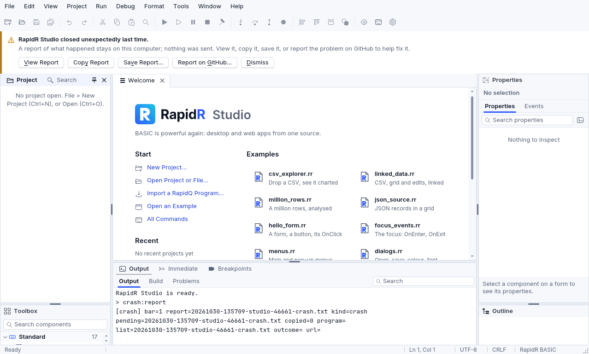
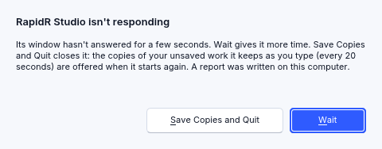

# Troubleshooting

## Installing and starting

**macOS: “RapidR Studio” Not Opened — Apple could not verify it is free of
malware** — RapidR's downloads aren't signed yet. Click **Done**, open **System Settings >
Privacy & Security**, scroll to *Security* and click **Open Anyway** next to
“RapidR Studio” was blocked (then your password or Touch ID). Once is enough.
Right-click > Open doesn't work on macOS 15 and newer. In the Terminal:
`xattr -dr com.apple.quarantine "/Applications/RapidR Studio.app"`. With
screenshots: [Install on macOS](getting-started.md#install-on-macos).

**Windows: "Windows protected your PC"** — SmartScreen, for the same reason.
Click **More info**, then **Run anyway**
([Install on Windows](getting-started.md#install-on-windows)).

**Linux: `N: Download is performed unsandboxed as root as file … couldn't be
accessed by user '_apt'`** — apt's note about a `.deb` in your home folder.
It is harmless: the install went on.

**Linux: `error while loading shared libraries: libssl.so.3`** — RapidR
needs OpenSSL 3: Ubuntu 22.04 or Debian 12 and newer (`sudo apt install
libssl3`). Ubuntu 20.04 and Debian 11 have only OpenSSL 1.1 and aren't
supported.

**Windows: "This app can't run on your PC"** — you have the installer for
the other kind of processor. Look at *Settings > System > About > System
type* and take the `x64` or the `arm64` installer to match
(see [Install on Windows](getting-started.md#install-on-windows)).

**Linux: `apt` says `Unable to locate package rapidr_2.119.0_amd64.deb`** —
put `./` in front of the file name (`sudo apt install
./rapidr_2.119.0_amd64.deb`) so apt reads it as a file in this folder.

**Linux: `dpkg` says "package architecture (amd64) does not match system
(arm64)"** — wrong file for this machine. `dpkg --print-architecture` says
which one to take (`amd64` or `arm64`).

**`rapidr: command not found`** — run `rapidr setup` from the install
(macOS: `/Applications/RapidR Studio.app/Contents/MacOS/rapidr setup`) to link it
into your PATH; on Windows, tick "Add rapidr to PATH" in the installer.

**"This program needs RapidR Runtime x.y.z or newer"** — the program was
compiled by a newer RapidR. Install the newer Runtime (the message links to
the releases).

**A downloaded program asks before it runs** — by design: a program from
the internet asks once; the answer is remembered for that exact file.

## Building

**`Failed to run cargo … Native builds compile with Rust`** — run
`rapidr setup`. Native builds are the only ones that need Rust: `rapidr
run`, `build --interp` and `bundle-bc` don't.

**macOS: `codesign … 3dcube.app: No such process`** — `codesign` reads a
name that starts with a digit as a process number. `rapidr build` now
passes the app's full path and signs it fine; when you run `codesign`
yourself, write `./3dcube.app` (see [The app's
name](building-apps.md#the-apps-name)).

**The first native build takes minutes** — it compiles RapidR's runtime
once; later builds reuse it (keep `CARGO_TARGET_DIR` if you set one).

**Windows: `Access is denied. (os error 5)` on the new program, or `Your
antivirus blocked the new program`** — see [Antivirus](#antivirus).

**`run-time error: 'GetTickCount' is a Windows function (kernel32): this
program calls Windows itself, so it runs on Windows only. For every system,
use TIMER`** — the program calls Windows' DLLs, which only exist on
Windows. Run it there, or use the portable equivalent the message names.

**`'X.DLL' is a 32-bit DLL; RapidR programs are 64-bit, so Windows can't
load it`** — the DLL came with an old program; a 64-bit build of it is
needed (or RapidR's own component for the job).

**`can't find the DLL 'X.DLL'`** — the DLL isn't one of Windows' and isn't
in the current folder or beside the program.

**`the call to F in user32 crashed (access violation …)`** — the DLL was
given something that isn't the pointer or handle it expects: often a TYPE
whose fields hold pointers or handles as `LONG` (64-bit Windows wants them
8 bytes wide), or a control's `Handle` (only a form's is a real window).

**`'SetWindowLongA' is given CODEPTR(WndProc), a callback …`** — SUBs
handed to a DLL to call back aren't supported yet.

**`address … isn't memory of this program`** — PEEK / POKE / MEMCPY reach
only the program's own memory (VARPTR of a variable, an element, a TYPE, a
stream's Pointer) and the console's pages.

**`RUSTSTART ... RUSTEND blocks only work in native builds`** — as it says.

**`--web` fails with "Failed to run wasm-bindgen"** — native web builds need
`rustup target add wasm32-unknown-unknown` and `cargo install
wasm-bindgen-cli --version 0.2.129`. `rapidr bundle-bc` needs neither.

## Antivirus

A Windows antivirus looks at every new `.exe` the moment it is written. A
program it has never seen — and every program you build is new — can't be on
its list of known programs, so it is judged by guesswork, and the guess is
sometimes wrong: a **false alarm** (a *false positive*). Nothing is wrong with
your program or with RapidR.

**What you see**

- A native build stops with `…\release\<program>.exe: Access is denied. (os
  error 5)`, and then `Your antivirus blocked the new program`. The
  antivirus holds the file: RapidR can't read it.
- Or `The new program disappeared right after it was built`: the antivirus
  moved it to its quarantine.
- Or the antivirus' own notice ("threat blocked", a name like
  `Gen:Variant…`).

**What RapidR does**

- It waits up to 10 seconds, in case the antivirus is only scanning (it
  usually lets go), and then builds on.
- A native program is linked with version information and a manifest (it
  asks for no more rights than you have), so it looks like an ordinary
  program. In RapidR's own tests an antivirus that refused small native
  programs without them let the same programs through with them. The icon
  and your app's details are written over them afterwards.
- It can't overrule the antivirus. If it still blocks the program, the
  message names the folders to deal with: RapidR's build folder (by default
  `%LOCALAPPDATA%\RapidR\Cache`, or your `RAPIDR_BUILD_CACHE`) and the folder
  the app goes to.

**What you do**

1. Open the antivirus' notices or quarantine, restore the program and choose
   *allow* (or *trust*).
2. Or add the two folders to the antivirus' exceptions, and build again. Do
   it only for folders that hold your own programs.
3. **Tell the antivirus maker.** False alarms are corrected when they are
   reported: every maker has a page for it (search for the product's name and
   "report a false positive"). Send the file from the quarantine and the
   threat name from the notice. The fix usually arrives within days, in an
   update, for everyone.

**Signing.** A program signed with a code-signing certificate is trusted far
more by antivirus programs and by SmartScreen. When you give an app to other
people, signing it with your own certificate (`signtool sign …`) is the real
cure for warnings and false alarms; RapidR's own downloads aren't signed yet
([Building apps](building-apps.md#windows)). A standalone interpreted app
(`rapidr build prog.bas --interp`) is made from RapidR's ready-made runner;
it was not refused in RapidR's tests.

## The program's output

**`PRINT a, b` prints the values joined** — the comma works like a
semicolon. Put spaces in yourself, or use `TAB(n)` / `FORMAT$`.

**Numbers print with nine decimals (`3.500000000`)** — the classic format. Use
`FORMAT$("%.2f", x)` or `STRF$` for others.

**A large number prints as `-2147483648`** — PRINT shows a whole number as
a 32-bit integer. `STR$(x)` gives `1E10`, `FORMAT$("%.0f",
x)` gives `10000000000`.

**`i = 2.7` stores 2** — stores into integer variables truncate. Use `ROUND` (which is `INT(x + 0.5)`) when you mean rounding.

**A string with `""` in it comes out wrong** — `""` isn't an escaped quote
in RapidR's BASIC. Use `CHR$(34)` or `$ESCAPECHARS ON` and `\"`.

**`ON ERROR GOTO` doesn't catch an error** — it's accepted and ignored;
run-time errors end the program with their message and line.

**`[WARN] x.Method() not implemented for type …`** — the component doesn't
have that member on this runtime (for example a web-only component on the
desktop). The program goes on.

## Windows and drawing

**A blank or crashing window in a virtual machine or over remote desktop**
— RapidR draws on the CPU when the only GPU is a software one; if
detection fails, set `RAPIDR_RENDERER=cpu`.

**The program doesn't look like the classic Windows look** — programs are drawn
in RapidR's own look unless they say `$THEME Classic` (the classic look;
sizes and places are the same in both). Check also for a `RAPIDR_THEME`
variable in your environment, which gives its theme to programs that name
none ([Themes](components.md#themes)).

## The web

**A blank page from a bundle** — serve the folder over HTTP
(`python3 -m http.server -d folder 8080`); browsers don't load WebAssembly
from `file://`.

**RMySQL / RServerSocket do nothing in the browser** — browsers can't open
raw TCP connections. Call a server of yours through RHttp.

**A file the program reads isn't found on the web** — files beside the
program are built into the page only with the listed extensions (`.csv`,
`.db`, `.txt`, `.png`, …); other names are fetched from the page's server.
See [The web](web.md#files-and-assets).

## Data and tables

**An `RCSV` or an `RDBGrid` shows no rows** — the file wasn't read: the
`RCSV`'s `Error` says why (`there is no file "people.csv"`) and its
`OnError(Message)` fires; the program goes on. A `FileName` without a folder is
looked for in the current folder, then beside the program; in a browser, the
file must be one of the page's files ([Data science with RapidR](data-science-with-rapidr.md#good-to-know)).

**The designer shows no data for a linked component** — the designer reads only
files inside your project (next to the program), and only to read.

## The AI assistant and RAI

**There is no Assistant pane or button** — it appears once the assistant is on
and set up: a provider, a key (a model server on your own computer needs none)
and a model. **Tools > AI Settings…** shows what is missing
([Setting it up](ai-assistant.md#setting-it-up)).

**"an API key is written in the program…" when building** — a key in a program
can be read by anyone who has the app. Take it out and let the program ask for
it: `APIKeySource = "env:NAME|ask"`
([Keys in programs you give to others](ai-assistant.md#keys-in-programs-you-give-to-others)).

**A provider's answer is an error** — `OnError` and the assistant say it in
plain words: a refused key, no credit left, a model your key can't use, too
many requests. On a web page, a model server on your computer (Ollama, LM
Studio) must allow the page's address ([Providers](ai-assistant.md#providers)).

## When RapidR crashes

RapidR Studio is written so that a mistake in its own code doesn't end it:
the error is said, your unsaved work is kept, and Studio goes on. When
something worse happens — an error in RapidR's own code that ends Studio or
your program, a stack overflow, or Studio's window not answering — RapidR
writes a **report on this computer**. Nothing is sent anywhere: RapidR has no
telemetry. You decide whether anyone sees a report.

**The next time Studio starts**, a strip under the tool bar says so:



- **View Report** opens it in a tab; **Copy Report** copies its text (to
  paste where you ask for help); **Save Report...** saves a copy where you
  choose.
- **Report on GitHub...** first says what happens: your browser opens
  RapidR's page for a new issue on GitHub, filled in with the report.
  Nothing is sent until you send it there yourself. You need a GitHub
  account (GitHub's terms ask that you be 13 or older; a younger student can
  ask a teacher or a parent); issues are public, so read the report first.
  A report too long for the page's address is copied, to paste into the
  issue.
- **Dismiss** closes the note. Any answer and Studio doesn't ask again.
- Your unsaved work is offered too ("Restore your unsaved work?"), as after
  any unexpected end.
- With School Lock on, the strip isn't shown.

**When your program stops** because of a problem in RapidR (not an error in
your code — those are run-time errors, shown as always), the Output says
where it was, with links to the line and to the report:

```
[main.rr ended, exit code 101]
Your program stopped: index out of bounds, at main.rr line 24, in SUB Tick (OnTimer of Ticker).
RapidR stopped it: a problem in RapidR, not in your code. A report stays on this computer: View Report
```

**When Studio stops answering** for 5 seconds, a hang report is written at
once and a small window asks: *RapidR Studio isn't responding* —
**Wait** (it asks again after 30 seconds if it still doesn't answer) or
**Save Copies and Quit** (Studio closes; the copies of your unsaved work it
keeps as you type, every 20 seconds, are offered when it starts again). If
Studio answers again, the window goes away by itself and the report says how
long it took.



**What a report has**: what happened in plain words and the error's message;
RapidR's version and git commit; your system's name; where your program or
Studio was (file, line, SUB or FUNCTION, the event being handled); what
Studio was doing (its last command); the Rust backtrace (the names of
RapidR's functions); the names of the last AI and MCP calls (never what was
sent); RapidR's own last 50 messages. **What it never has**: your home
folder's path (it shows as `~`), the contents of your files, keys, tokens or
passwords (taken out by their shapes, and any value your program marked as
a secret), or values from your program.

**Where they are**: `~/Library/Application Support/RapidR/crashes` (macOS),
`%APPDATA%\RapidR\crashes` (Windows), `~/.local/share/rapidr/crashes`
(Linux), one text file each, readable only by you. Reports older than 30
days, and past the newest 20, are deleted. The example
[`examples/studio/crash_reports.rr`](../../examples/studio/crash_reports.rr)
lists them (RProject's `CrashList`, `CrashText`, `CrashField`).

**What isn't covered yet**: apps you build and give to others (opt-in
reports for them come later); RapidR Studio on the web; on Windows, a stack
overflow ends the program with the system's message and no report (a panic
is reported). After a stack overflow or a fatal signal the report is a
shorter one, without a backtrace: at that moment only the place in your
program can be read safely. A hang report names the threads but has no
backtrace of the stuck one.

## Reporting a problem

Open an issue on GitHub (there are forms for bugs, compatibility and
test reports): <https://github.com/iBobX/RapidR/issues>. An older program
that behaves differently under RapidR is a bug — please include it. Report
security problems privately, as [SECURITY.md](../../SECURITY.md) explains.
