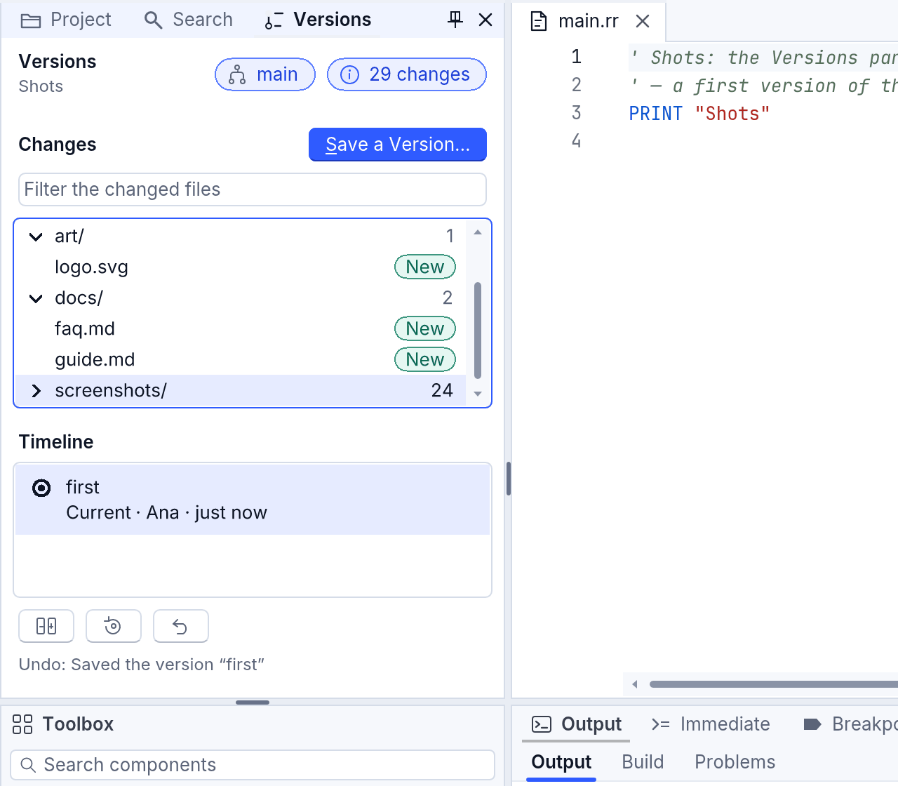
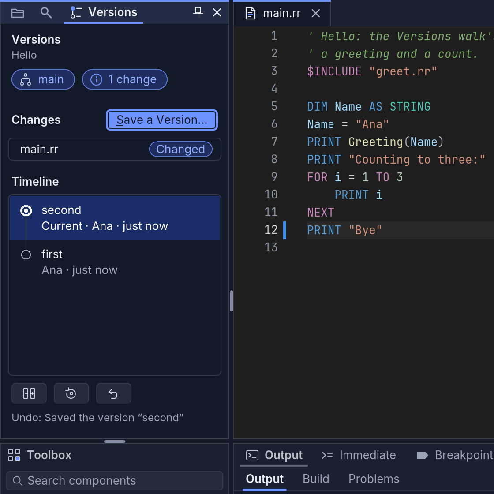

# Versions: never lose your work

**Versions** keeps every saved state of your project, shows what changed
between any two, and takes you back to any of them. It is Git underneath
(the same repositories every Git tool opens), in plain words on top: each
word in RapidR Studio has its Git name in a tooltip, so you learn real Git
without noticing.

And even before you start: Studio keeps a copy of a file **every time you
save it** — the [local history](#local-history-every-save-kept). Nothing you
save is ever lost.

## Versions in RapidR Studio

### Start keeping versions

The **Versions** tab is always there, beside **Project** and **Search** in
the left column (click it, or **View > Versions**). With no project open it
says so; with a project that doesn't keep versions yet, it says what a
version is and has one button: **Start Keeping Versions of This Project**
(also **File > Versions > Start Versioning This Project**). From then on
the project's folder keeps versions.


Closed the tab? It stays closed, even after Studio starts again, until
**View > Versions** brings it back (**View > Reset Layout** too). When the
left column is narrow, its tabs show their icons only — each one's name is
in its tooltip and said by a screen reader —, the tab in front keeping its
name when it fits.

Studio starts versions in a project's **own folder** only. It says why, and
starts nothing, for a whole drive, your home folder or its Desktop,
Documents or Downloads (they hold much more than one project), and for a
folder inside another one that already has versions. Put the project in a
folder of its own first (File > New Project).

### Save a version

**File > Save a Version...** — **Ctrl+Shift+V** (Cmd+Shift+V on a Mac; "V"
for version. Ctrl+S stays **Save**: it saves the file, a version saves the
whole project's state) — or **Save a Version...** in the pane:


- **What changed:** a few words ("Bigger button", "Fixed the total"). They
  are what the timeline shows.
- **Files in this version:** every changed file is ticked; untick the ones
  to keep out of this version (Space ticks or unticks one).
- **Your name:** saved with the version, remembered.

Files open with unsaved changes are saved first (Studio asks, as when you
close them): a version keeps what is on the disk.

**A check for keys and passwords.** Before saving, Studio reads the lines
you added. A line that looks like a private key, an API key, an access
token or a password written in the code stops the save: the dialog says
which file and line, with the secret masked. Take it out (keep real secrets
with [RSecrets](secrets.md)), or tick **These aren't real keys or
passwords: save them anyway** — only then does **Save Anyway** save.


### The Versions pane

At the top: **Versions**, your project's name, and two chips — the
experiment you're on (**main**: Git calls it a branch) and how many files
have changes not saved as a version (**All saved** when none).

**Changes** lists those files, with **Save a Version...** — the pane's main
button — at its right:

- the project's own files first, then **one row per folder** with how many
  of its files changed; a folder of more than five files starts **closed**
  when the list is long. Click its arrow (or pick it and press **Right**)
  to open it, **Left** to close it;
- each file shows its **name** first — a long one is cut in the middle, so
  its end and extension stay —, and its change in words on a soft chip:
  **New**, **Changed** or **Deleted**;
- past 20 changed files, a **filter** box shows only the files whose name
  or folder has the letters you type;
- your system's own files (`.DS_Store`, `._` copies, `Thumbs.db`,
  `desktop.ini`) are never listed and never saved in a version.



The **Timeline** is every version, newest first: a line through a dot for
each, its words (on two lines when they need them), who saved it and when.
The newest — the **current** version, the one your files are based on —
has a ring in the accent colour. An AI's checkpoints (what the assistant
keeps before it changes your files) have a smaller, lighter dot. Pick a
version and **What Changed?** and **Go Back...** act on it; **Undo** takes
back the last action. The three sit in one row under the timeline, as wide
as each other, and under them, in dim words, what Undo would take back. A
right click on a version (or Shift+F10 when the timeline has the keys) opens
the same actions in a menu: **What Changed?**, **Go Back to This Version...**,
**Go Back to This Version for** the file open, and **Undo**.


The pane fits any width: in a narrow column the chips go under the title
and the three buttons show their icons alone (each named in its tooltip and
for a screen reader) — nothing is cut off, nothing wraps.



### What changed?

As you work, the editor marks the lines that differ from the last version
in its gutter — a bar for added and changed lines, a small triangle where
lines were removed —; the Project pane shows the file's **M**, and the
status bar the experiment you're on ("main": Git calls it a branch) and how
many files have changes not saved as a version.


Click a mark (or **File > Versions > Show This Line's Change**, for the
caret's line) to see what the lines were. **Undo This Change** puts them
back as the last version has them — one Ctrl+Z brings your change back.
Escape closes it.


Pick a version in the timeline and press **What Changed?** (or double-click it): the
files it changed open in a tab beside your code, each file's lines before
and after, the changed words marked.


### Go back

Pick a version, then **Go Back...**: **The Whole Project** or **Only This
File** (the file open). Studio asks first — Cancel is the default:


Going back saves a **new** version with that version's files ("Went back to
“first”"): the newer versions stay on the timeline, nothing is thrown
away, and Studio keeps a hidden safety point before it changes any file.
Going back for one file leaves the other files — and their unsaved changes
— as they are.

### Undo

**Undo** (in the pane, or File > Versions > Undo the Last Versions Action)
takes back the last thing done to the versions — a save, a go back —, even
the next day. The pane says what it would undo. Undo refuses, changing
nothing, when it would overwrite work you did afterwards: it says which
file, so you can save a version first.

### Local history: every save kept

Every time Studio saves a file — versioned or not — it keeps a copy, and
the file as the disk had it before Studio first wrote it. **File > Versions
> Local History of This File...** (or **Local History...** in the pane)
lists the copies, newest first; pick one to compare it with the editor, and
**Restore This Copy** puts its text in the editor as one step (Ctrl+Z takes
it back; save to keep it).


The copies live in the project's `.rapidr/history` folder: each content
once, checked when read back (a damaged copy is said, never shown as your
file), the newest 100 of each file; a file over 8 MB isn't copied. That
folder is never part of a version, and you can delete it: only the copies
go.

### In a browser

Studio in a browser can't keep versions yet (the Git engine, gitoxide,
doesn't run in a browser): the Versions pane says so. The **local history**
works there too, in the browser's own storage.

### The keys

| Action | Keys |
|---|---|
| Save a Version... | Ctrl+Shift+V (Cmd+Shift+V) |
| Pick a version | Up and Down in the timeline, then Tab to What Changed? or Go Back... |
| What a version changed | Enter (or a double click) on it |
| A version's menu | a right click on it, or Shift+F10 (the menu key) |
| Open a changed file | a double click (or Enter) in the changes list |
| Open or close a folder of changes | Right / Left (or Space), or a click on its arrow |
| Show only some changed files | type in the filter box (more than 20 changes) |
| Close a change shown under its line | Escape |
| Every Versions command | File > Versions, or the command palette (Ctrl+Shift+P, "Versions") |

Every control has a name for screen readers: a changed file's row says
"logo.svg in art: new, not in a version yet", a folder's "Folder
screenshots, 24 changes, closed", a version's "first, saved by Ana, 2
minutes ago" (the newest adds "the current version"), the chips "Experiment:
main" and "3 changes not saved as a version", and the Project pane's rows
say their change in words too.

## The ideas, in plain words

| You say | What it means | Git calls it |
|---|---|---|
| **Start keeping versions** | The project's folder starts keeping versions. | `git init` |
| **Save a version** | A snapshot of your files, with a few words about what changed. You choose all changed files or some. | commit (with staging) |
| **Timeline** | Every version, newest first: its words, who saved it, when. | log |
| **What changed?** | The differences: since the last version, or what a version changed. | diff |
| **Go back** | The whole project, or one file, as it was in an older version. It is saved as a *new* version, so the newer ones stay on the timeline. | revert (never a hard reset) |
| **Experiment** | A separate line of versions to try something, without touching the main one ("main"). | branch |
| **Undo** | The last action taken back. | (RapidR's own history of actions) |
| **Local history** | A copy of a file at every save, versioned or not. | (RapidR's own) |

## Nothing is ever lost

- **Safety points.** Before anything that rewrites files or moves a
  version (going back, restoring, switching, bringing in, getting the
  latest), Versions quietly saves the whole folder as it is, unsaved
  changes and new files included. Safety points never show on the
  timeline and are never shared.
- **Undo.** Every action goes into a history, and **Undo** takes the last
  one back, even the next day.
- **Unsaved changes are never thrown away.** Going back saves your open
  files first, and waits when there are changes not saved as a version.
- **The local history.** Every save keeps a copy of the file.
- **The AI's checkpoints.** Before the assistant changes your files, a
  checkpoint keeps them as they were.

## Safe with any folder

Opening a project never runs anything from it: no hooks, no filters, no
programs named in its settings. A project that belongs to another user
account on your computer (or comes from a USB stick or a network drive)
isn't opened for changes: Versions explains why and opens it read-only, to
look at its versions.

## RRepository: versions in your own programs

Studio's Versions pane is built on **RRepository**, a component any program
`rapidr run` runs can use too (it is one of the IDE components, with
RProject and RLanguageService):

```basic
DIM Repo AS RRepository
Repo.Folder = CURDIR$
IF Repo.Versioned = 0 THEN Repo.Start
PRINT Repo.ChangeCount; " file(s) not saved as a version"
IF Repo.ChangeCount > 0 THEN
    IF Repo.SaveVersion("Saved from my program") = "" THEN PRINT Repo.Error
END IF
PRINT Repo.Timeline(5)
```

Its members are in the [reference](reference/components.md): `Start`,
`SaveVersion` (with `CheckSecrets` and `Secrets`), `Timeline`,
`VersionFiles`, `FileAt`, `GoBack`, `GoBackFile`, `Undo` and `CanUndo`,
`History`, `Checkpoint`, and the local history's `Snapshot`, `LocalHistory`
and `SnapshotText`. Errors are said in plain words (`Error`), their kind in
`ErrorKind`.

The code editor's side is RCodeEditor's `ChangeBase` (the gutter's marks
against a version's text), `ChangeAt`, `ShowChange` and `RevertChange`;
RProjectTree's `FileBadge` draws a file's letter; RDiffView's `ReadOnly`
shows what changed without Accept and Reject.

## RDiffView: three ways to see what changed

`RDiffView` compares two texts. Its `Kind` says how:

| Kind | What it shows |
|---|---|
| `"text"` (the default) | Line by line, side by side or in one column. The changed **words** are marked, and each run of changes (a hunk) has Accept and Reject buttons (none with `ReadOnly`). |
| `"form"` | Two versions of a program's forms: the form **before and after**, drawn as the designer draws it, the changed components outlined (green added, red removed, blue changed), and the changes listed: "GreetButton: Caption "&Greet" → "&Say hello"; Width 90 → 110". |
| `"table"` | Two CSV files as one table: added rows green, removed rows red, a changed row as its old values over its new ones with the changed cells marked, a new column tinted. Rows are matched by their first column when its values are unique (an Id), else by their content. |

```basic
CREATE Diff AS RDiffView
    Left = 8: Top = 8: Width = 800: Height = 460
    Kind = "table"
END CREATE

Diff.LeftText = "Id,Name,Score" + CHR$(10) + "1,Ana,10" + CHR$(10)
Diff.RightText = "Id,Name,Score" + CHR$(10) + "1,Ana,12" + CHR$(10)
PRINT Diff.ChangeCount     ' 1
PRINT Diff.Summary         ' Row 1 (Id 1): Score 10 → 12
```

`Summary` says every change in words, one per line: what a screen reader
reads, and what you can show or log. `ChangeCount` counts them.


The example is [examples/studio/diff_views.rr](../../examples/studio/diff_views.rr):
`rapidr run studio/diff_views.rr` from the examples folder.

The form view needs RapidR Studio's form designer to read the forms:
`rapidr run`, RapidR Studio and programs in the browser have it. An
executable built on its own shows a note there instead.

## For the curious

- The diff is RapidR's own: Myers' algorithm, written from his 1986 paper,
  the same for RDiffView, Versions, the editor's marks and the assistant's
  changes. A 4,500-line file is compared in well under 50 ms.
- The repositories are ordinary Git repositories (gitoxide, a Git engine
  written in Rust): other Git tools open them, and RapidR opens theirs.
  Starting versions writes a `.gitignore` that keeps RapidR's own folder
  (`.rapidr/`), what Build writes beside the program and your system's own
  files (`.DS_Store`, `._*`, `Thumbs.db`, `ehthumbs.db`, `desktop.ini`) out
  of them — edit it to keep out more. Those system files are left out even
  in a project whose `.gitignore` doesn't name them.
- Safety points and checkpoints are commits under `refs/rapidr/`; the
  history of actions is `.git/rapidr/history.jsonl`; the local history is
  `.rapidr/history/index.jsonl` and its `blobs/` (each named by its
  content's SHA-256).
- Coming next: experiments in the pane, bringing one into main with a
  form-aware merge, who wrote each line, sharing online, and a Pro level
  with Git's own words.
