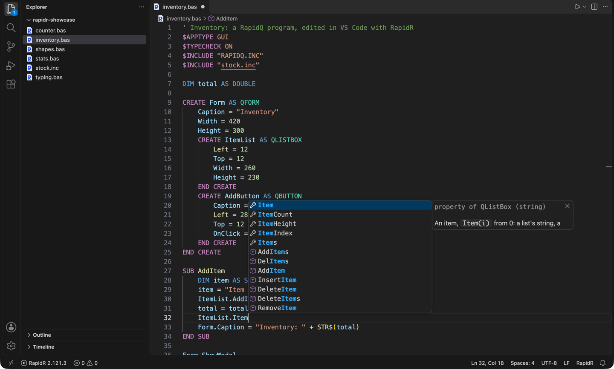
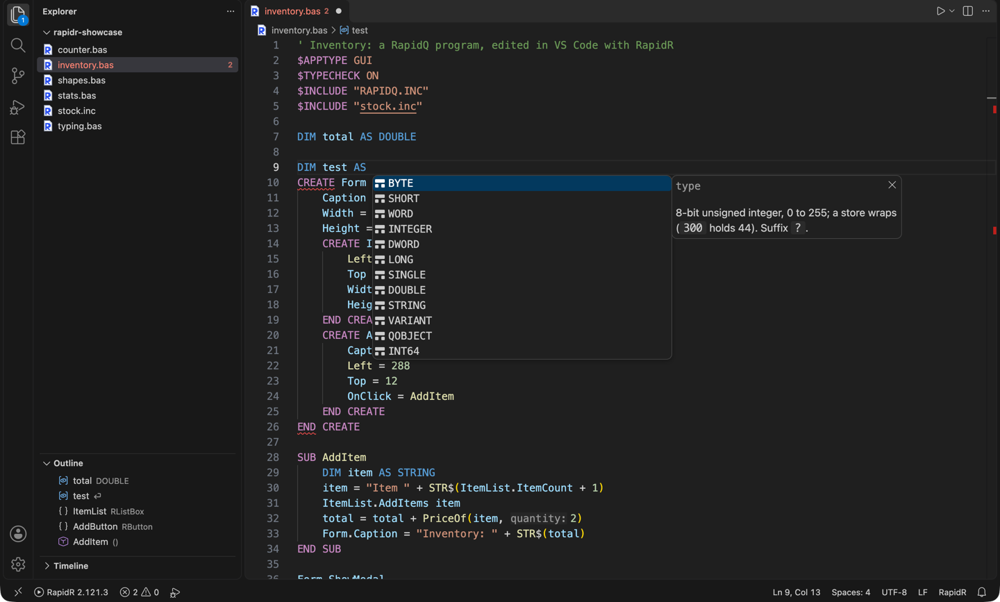
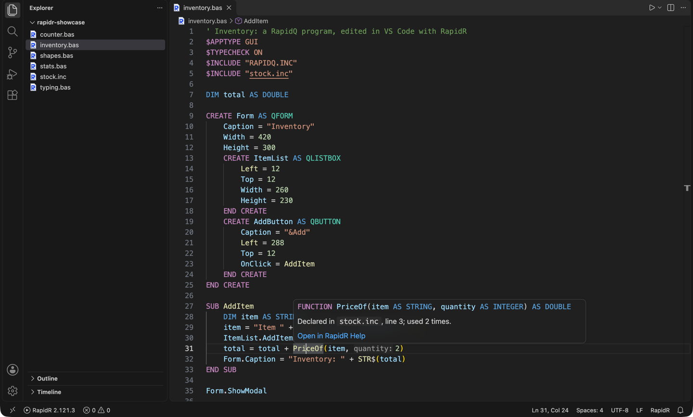
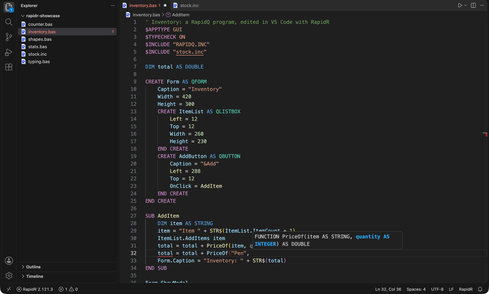
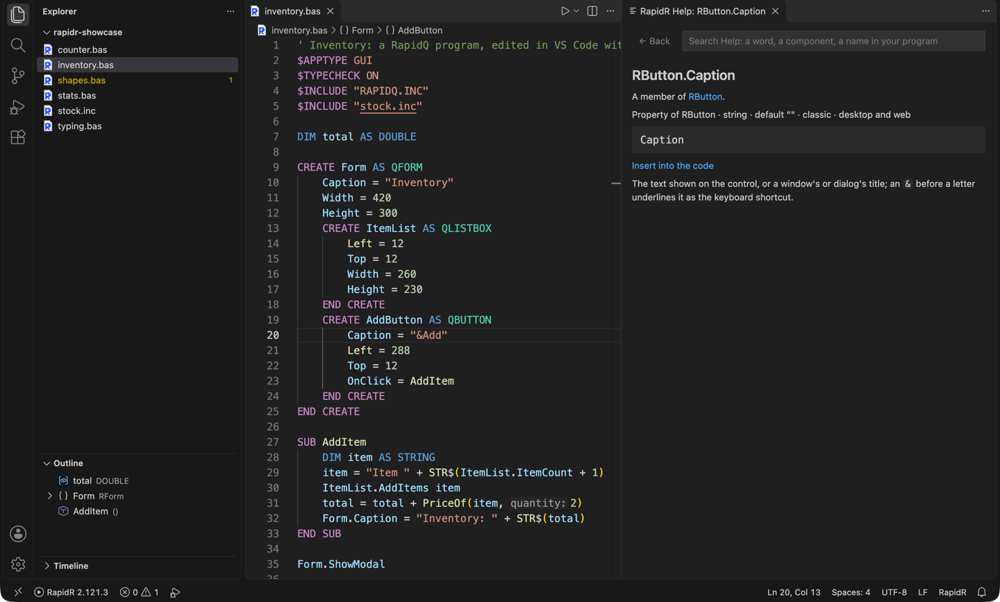
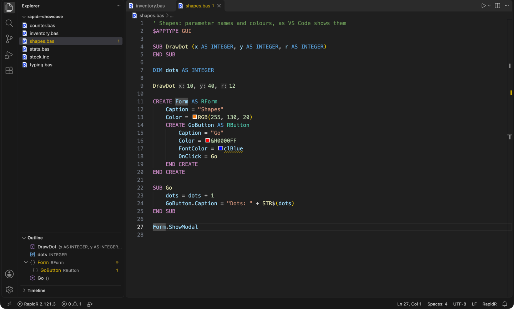
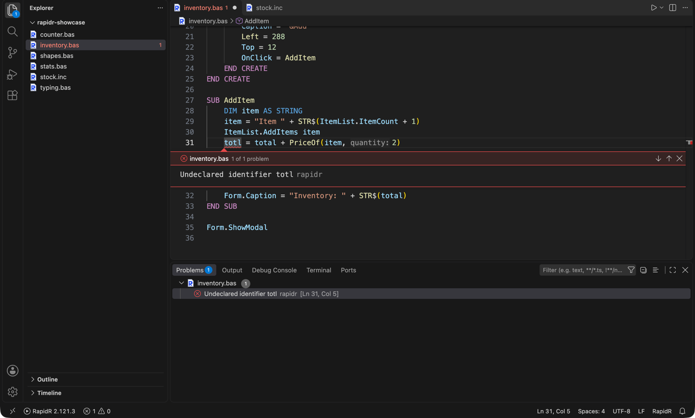
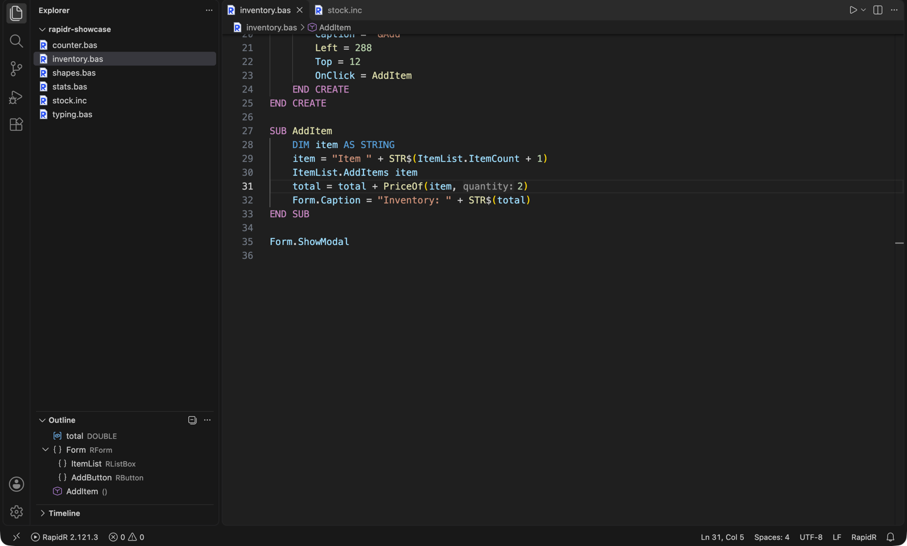
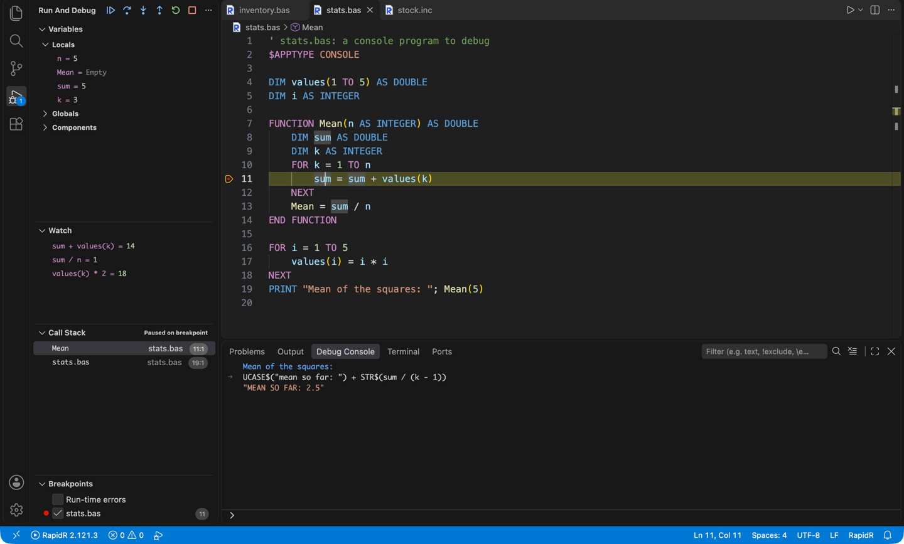
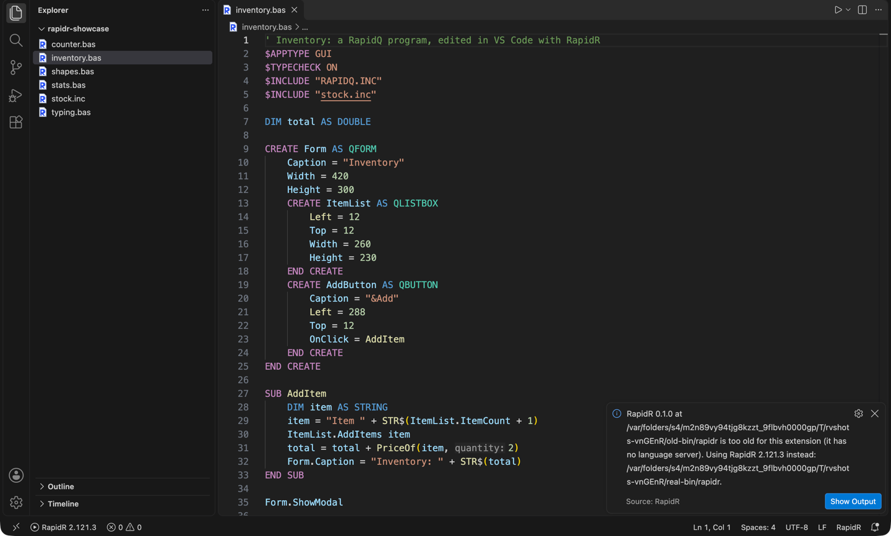

# RapidR for Visual Studio Code

Write, run and debug **RapidR BASIC** programs (RapidQ-compatible) in VS Code: `.bas`, `.rr`, `.inc`, and RapidQ's own `.rqw`, `.rqb` and `.rq` are recognised too.

[RapidR](https://github.com/iBobX/RapidR) is compatible with RapidQ and written from the ground up in pure Rust. It has a compiler for native executables, an interpreter, and a web runtime. RapidQ programs run unchanged. RapidR adds data science, data components and modern GUI features.

This extension is a thin client. The language intelligence comes from RapidR itself: `rapidr lsp` is the language server and `rapidr dap` is the debugger. VS Code therefore gives the same answers as RapidR Studio, and both understand your program the way the compiler does.

> **You need RapidR installed.** Download it from the [releases page](https://github.com/iBobX/RapidR/releases). The extension looks for `rapidr` in the usual install places and on your `PATH`, uses the newest one it finds that is as new as the extension, and shows its version in the status bar. If it can't find one, it says so and asks you where it is.

## Features

### Code completion that knows your program

The completion list includes the builtins, the keywords, the components (offered under RapidR's names, such as `RButton`, with "RapidQ name: QBUTTON" as the detail; in a RapidQ-compatible project they are offered under RapidQ's names, with "RapidR name: RButton") with their properties, methods and events, and your own variables, SUBs, FUNCTIONs and TYPEs. It also covers the files you `$INCLUDE`, as the editor has them, saved or not.

```basic
CREATE Form AS RForm
    Caption = "Hello"
END CREATE

Form.          ' ← Caption, Width, ShowModal, OnClose, …
```



Type `DIM test AS ` and the list of types and components opens by itself:



### Hover, signature help and parameter names

Hover a builtin, a component ("RButton — RapidQ name: QBUTTON"), a component member or one of your routines to see its signature and documentation. The hover ends with **Open in RapidR Help**. While you type a call, its parameters are shown, and the parameter's name is written in grey before each literal argument (`DrawDot x, y: 40, r: 12`).

```basic
s$ = MID$(text$, 2, 3)     ' MID$(str, start, [length])
```





### RapidR Help beside your code

Put the caret on a word and press **Shift+F1** (or choose **RapidR: Help for the Word at the Cursor**, or **Open in RapidR Help** in a hover). The page RapidR Studio's Help shows opens beside the editor: what the word is, the syntax, what it does, a component's properties, methods and events as links, and for your own names where they are declared and what uses them. **Insert into the code** types the syntax at the caret, **Back** goes back, and the box at the top searches the language and your program.



### Colours you can see and pick

`RGB(255, 130, 20)`, `&H0000FF` and `clBlue` show a colour swatch. Click it for VS Code's colour picker; the colour is written back the way you wrote it (`RGB(…)` or `&HBBGGRR`).



### Diagnostics in RapidQ's words

Errors and warnings appear as you type, worded the way RapidQ's compiler words them:

```basic
$TYPECHECK ON
total = 1                  ' Undeclared identifier total
```



Turn on **RapidQ-compatible** (`rapidr.rapidqCompatible`) for programs that must still compile with RapidQ: RapidR's own components (`RPlot`, which RapidQ lacks) are flagged, and so are RapidR's names of RapidQ's components ("RButton is RapidR's name: RapidQ's compiler knows it as QBUTTON"), with a quick fix to the RapidQ name.

### Navigate and refactor

- **Go to Definition** (F12), including into `$INCLUDE` files; an `$INCLUDE "file"` line is a link to the file (Ctrl/Cmd+click).
- **Find All References** (Shift+F12), and every use of the name under the caret is highlighted.
- **Rename Symbol** (F2): a variable, SUB, FUNCTION, TYPE or component, everywhere it is used.
- **Outline** and breadcrumbs: SUBs, FUNCTIONs, TYPEs, the forms you CREATE and their components.
- **Format Document** and **Format Selection**: indentation, and keywords in one case. RapidR is the default formatter for RapidR files, so Format Document needs no question; for **format on save** add `"[rapidr]": { "editor.formatOnSave": true }` to your settings.
- **Automatic keyword case** as you type, as in QuickBASIC and VB: `dim x as integer` becomes `DIM x AS INTEGER` when each word is finished. Strings, comments and your own names are never touched; one Undo gives back what you typed.
- **Quick fixes** for what the language server finds (a RapidQ include the program needs, `NOT FILEEXISTS(x)`, RapidR's names in a RapidQ-compatible project).



### Run, build and debug

| Command | What it does |
|---|---|
| **RapidR: Run File** | Saves the file and runs it in the "RapidR" terminal: `rapidr run file.bas` |
| **RapidR: Debug File** (or F5) | Debugs it through `rapidr dap`: breakpoints, stepping, call stack, variables, watches |
| **RapidR: Build Native Executable** | `rapidr build file.bas --release` (needs Rust; `rapidr setup` installs it) |
| **RapidR: Build Standalone Executable (Interpreted)** | `rapidr build file.bas --interp`: one executable, no Rust needed |
| **RapidR: Bundle for the Web (.zip)** | `rapidr bundle-bc file.bas -o file-web.zip`: a folder any static web host serves |

Run and Debug are also on the editor's title bar. Every command is in the RapidR status bar item, which shows the version of RapidR in use.



While the program is stopped, watches, hovers and the Debug Console evaluate BASIC expressions in the frame you pick (`sum / n`, `UCASE$(name$)`, `Form.Caption`), and the Debug Console runs statements (`total = 100`). Conditional breakpoints, hit counts and logpoints (`adding {i} to {total}`) work, and so do step in, over and out, the call stack and the Variables view (Locals, Globals and the form's Components). Tick **Run-time errors** under Breakpoints to stop where an error happens, in event handlers too.

F5 works without a `launch.json`: it debugs the file in the active editor. To give a program arguments or a working folder, add a configuration:

```json
{
  "type": "rapidr",
  "request": "launch",
  "name": "RapidR: my program",
  "program": "${workspaceFolder}/main.bas",
  "args": ["--verbose"],
  "cwd": "${workspaceFolder}",
  "stopOnEntry": false
}
```

### Projects

A folder with a RapidR project (a `.rrproj` file, which RapidR Studio makes) gets **RapidR: Run Project**, **Debug Project**, **Build Project** and **Open the Project's Main File**, also on the project file's title bar and in the Explorer's context menu. They use the project's main file, its arguments and its working folder (`[run]` in the `.rrproj`). `.rrproj` files are highlighted as RapidR projects.

### Syntax highlighting and snippets

The extension highlights RapidR syntax (RapidQ-compatible programs included), with every component under RapidR's name and under its RapidQ name. The word lists of the grammar are kept in step with RapidR's language registry (`npm run grammar`), so a word a new RapidR adds is highlighted. It also has snippets for blocks (`if`, `for`, `select`, `sub`, `func`, `type`), forms and components (`createform`, `createbutton`, …), and program skeletons (`rpcons`, `rpgui`); every snippet is checked against the language server's own diagnostics.

## Settings

| Setting | Default | |
|---|---|---|
| `rapidr.path` | (empty) | The `rapidr` executable, the folder it is in, or `RapidR Studio.app`. When empty, the extension looks on `PATH`, then in the usual install places, then in a RapidR source checkout open in the workspace, and uses the first one that is as new as the extension (an older `rapidr` that has the language server is the fallback). |
| `rapidr.rapidqCompatible` | `false` | Warn about everything RapidQ doesn't have. |
| `rapidr.keywordCase` | `upper` | The case of keywords, types, directives and builtins: `upper`, `lower`, `proper` (`Dim x As Integer`) or `preserve` (off). |
| `rapidr.identifierCase` | `preserve` | `declaration`: write your names as declared, and members as RapidR spells them (`Form.Caption`). |
| `rapidr.trace.server` | `off` | Log the language server's messages in the "RapidR Language Server" output. |

## Commands

The commands above, and also:

- **RapidR: Help for the Word at the Cursor** (Shift+F1)
- **RapidR: Run Project**, **Debug Project**, **Build Project**, **Open the Project's Main File**
- **RapidR: Restart Language Server**
- **RapidR: Show Language Server Output**
- **RapidR: Locate rapidr…**

## Troubleshooting

- **"RapidR was not found."** Install RapidR, or choose **Locate rapidr…** and pick the executable. On macOS, you can pick `RapidR Studio.app`. On Windows, the installer puts it in `%LOCALAPPDATA%\Programs\RapidR\bin\rapidr.exe`.
- **"The RapidR found is too old."** A very old `rapidr` (version 0.1.0, from `cargo install`) on your `PATH` has no language server and no debugger. The extension skips it and uses a newer one (the installed RapidR) and tells you once; when none is new enough, a notification offers **Use the installed RapidR**, **Choose…** and **Download**. The status bar shows the version in use, and **RapidR: Show Language Server Output** lists every `rapidr` it looked at and why it used or skipped it.
  

- **No completion or diagnostics.** Run **RapidR: Show Language Server Output**. A RapidR older than the language server has no `rapidr lsp`, so update RapidR.
- **Untrusted workspaces.** In an untrusted workspace, the extension ignores the workspace's `rapidr.path` and doesn't run a `rapidr` built inside it.

## Licence

MIT. The bundled JavaScript packages and their licences are listed in [THIRD_PARTY_NOTICES.md](THIRD_PARTY_NOTICES.md).
